# B01／管理批號 G02｜太陽系戰爭 G011～G020

起始 main：`3fd2101399d90e30d377eb1572610e7cef7b7150`。本報告為本次工作證據，進度仍由實際檔案與既有索引／批次工具衍生。

## 製圖前來源一致性紀錄

validate 通過；status G02 為 0/20，plan 列出十套各缺兩圖、無既有圖。正式 owner VM 抽取、索引及 notes A 節逐欄一致；沒有猜測或更名。

| ID | 小區域 | 等級 | weapon | helmet | armor | shoes | accessory | sourceKey／來源 |
| --- | --- | --- | --- | --- | --- | --- | --- | --- |
| G011 | 太陽系戰爭 → 月面登陸區 | Lv.51～55 | 月塵振動刃 | 低重力作戰盔 | 月面複合甲 | 真空磁吸靴 | 月面導航晶片 | galaxy:solar:map:0 / worldmaps-solar.js:3 |
| G012 | 太陽系戰爭 → 月球軌道站 | Lv.56～60 | 軌道切割刃 | 真空密封盔 | 軌道作戰甲 | 艙外推進靴 | 軌道定位模組 | galaxy:solar:map:1 / worldmaps-solar.js:4 |
| G013 | 太陽系戰爭 → 火星殖民區 | Lv.61～65 | 赤原脈衝刃 | 火星戰術盔 | 殖民防衛甲 | 赤塵機動靴 | 火星環境模組 | galaxy:solar:map:2 / worldmaps-solar.js:5 |
| G014 | 太陽系戰爭 → 火星赤原戰場 | Lv.66～70 | 赤星重刃 | 沙暴戰盔 | 火星重型甲 | 赤原突進靴 | 戰區火控模組 | galaxy:solar:map:3 / worldmaps-solar.js:6 |
| G015 | 太陽系戰爭 → 小行星採礦帶 | Lv.71～75 | 礦脈震裂刃 | 採礦重盔 | 工業強化甲 | 零重力磁靴 | 礦帶掃描器 | galaxy:solar:map:4 / worldmaps-solar.js:7 |
| G016 | 太陽系戰爭 → 木衛戰區 | Lv.76～80 | 冰月能量刃 | 冰殼戰盔 | 低溫動力甲 | 冰面推進靴 | 木衛導航核 | galaxy:solar:map:5 / worldmaps-solar.js:8 |
| G017 | 太陽系戰爭 → 木星軌道圈 | Lv.81～85 | 重力脈衝刃 | 軌道重戰盔 | 高壓戰鬥甲 | 引力修正靴 | 重力控制模組 | galaxy:solar:map:6 / worldmaps-solar.js:9 |
| G018 | 太陽系戰爭 → 土星環防線 | Lv.86～90 | 環帶光刃 | 碎冰防衛盔 | 環軌防護甲 | 環帶機動靴 | 土星環定位器 | galaxy:solar:map:7 / worldmaps-solar.js:10 |
| G019 | 太陽系戰爭 → 外太陽系邊境 | Lv.91～95 | 深空切界刃 | 遠域探勘盔 | 深空生存甲 | 遠日推進靴 | 深空航標 | galaxy:solar:map:8 / worldmaps-solar.js:11 |
| G020 | 太陽系戰爭 → 太陽系終極戰線 | Lv.96～100 | 日耀終戰刃 | 恆星戰術盔 | 太陽系主戰甲 | 終極躍遷靴 | 太陽系主控核心 | galaxy:solar:map:9 / worldmaps-solar.js:12 |

data.js 的 solar 註冊 MAPS[10..19]；engine.js 五槽順序及 makeItem 掉落來源均核對。20 張最終概念圖已入庫；無使用者批准。

## 真實製圖與入庫

使用實際影像生成工具完成十張三視圖，再以各自三視圖作參照完成十張拆解圖；另兩次局部修圖，共 22 次成功產圖。Pillow 僅作 RGB／WebP 格式轉換（quality=90、method=6），沒有用程式合成假圖或改畫內容。未壓縮 PNG 與初稿留在本次環境 `/workspace/generated_images/`，不作 GitHub 永久備份承諾。

G011 拆解初稿的背部仍有導航晶片，局部修圖移除整個晶片，保留空掛座；G016 拆解初稿鎧甲含鞋，局部修圖改為空的脛部袖口，雙鞋獨立展示。兩處均已目視確認修正。其他八套無局部修圖。

所有圖片維持 `images-present-awaiting-user-review`、`conceptApproved=false`、`modelStatus=not-started`。圖上的自動生成小字可能有誤，不作正式名稱來源；以本報告上表與 notes A 節為準。概念比例與接口仍須後續工程驗證，本批不宣稱可直接生成模型。

## 二十張集中圖冊

### G011｜太陽系戰爭 → 月面登陸區

待確認的美術方向：月面圓弧加壓外殼、振動刃致動器、磁吸鞋底與可卸導航晶片。

**overview-front-side-back.webp** — 1491 × 1055，282,330 bytes（282.330 KB）。

SHA-256：`1a5e4e177883cceda4627fdfbfa418c59cbb9b214501e278b8621d470207fac7`

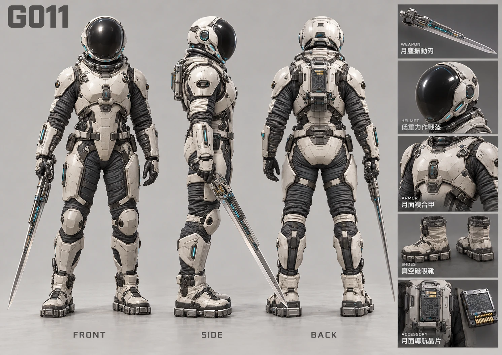

**equipment-five-slots.webp** — 1491 × 1055，281,700 bytes（281.700 KB）。

SHA-256：`296bbbb102119d0de525db63f763d93579e170158d2222e588a3b00d299d9788`

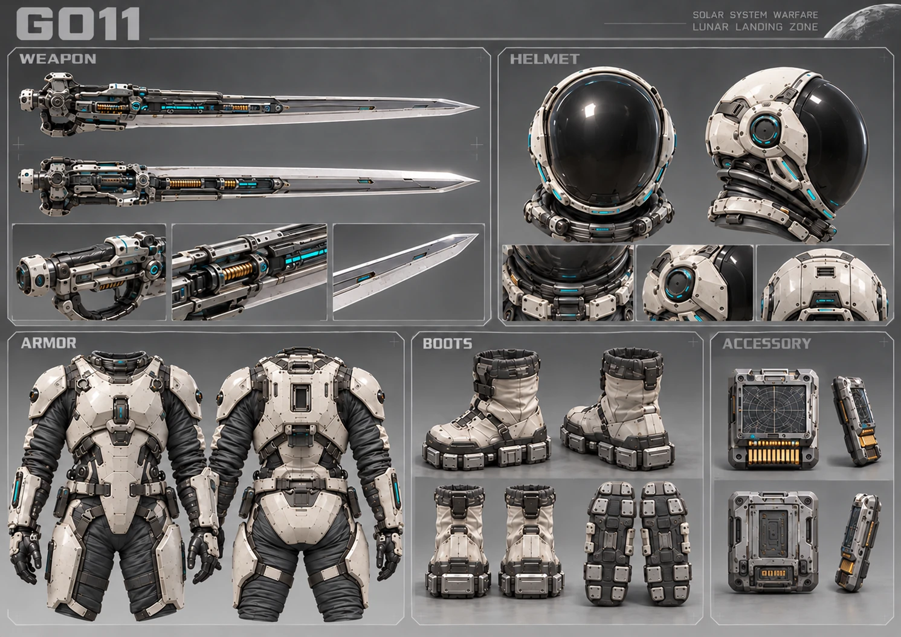

### G012｜太陽系戰爭 → 月球軌道站

待確認的美術方向：軌道艙外膠囊輪廓、切割導軌、腳踝推進器與圓盤定位模組。

**overview-front-side-back.webp** — 1491 × 1055，208,768 bytes（208.768 KB）。

SHA-256：`8e4c7b13915f7d56fba3a647d5ff043f95117fc506478d8022441049383fcd47`

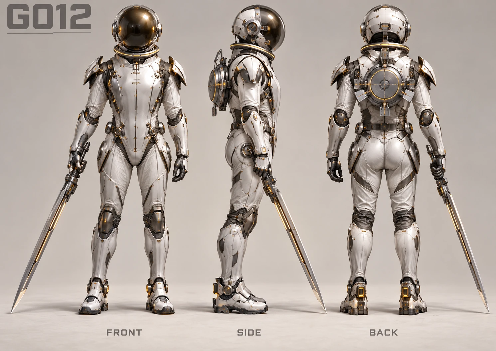

**equipment-five-slots.webp** — 1491 × 1055，231,800 bytes（231.800 KB）。

SHA-256：`f02e690f1836f93237803e591d40f45910781c55a1b9f6bb7ff4ab77d64cd666`

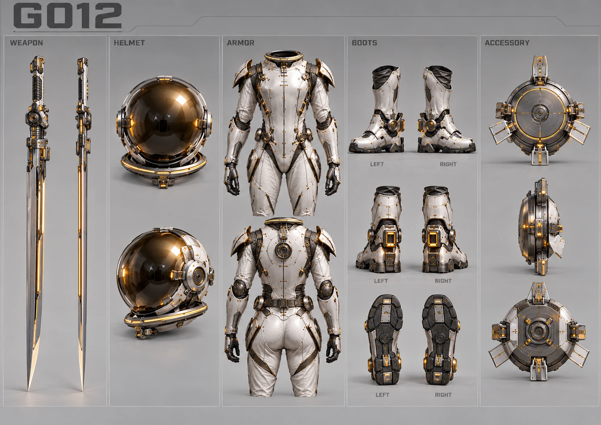

### G013｜太陽系戰爭 → 火星殖民區

待確認的美術方向：火星殖民柔性防塵服、脈衝刃三發射節點與環境濾芯模組。

**overview-front-side-back.webp** — 1491 × 1055，350,862 bytes（350.862 KB）。

SHA-256：`6062b968a6ffc2616dbb23b3da8bb7e74aa1635cf24b1f79cc6b18626d971849`

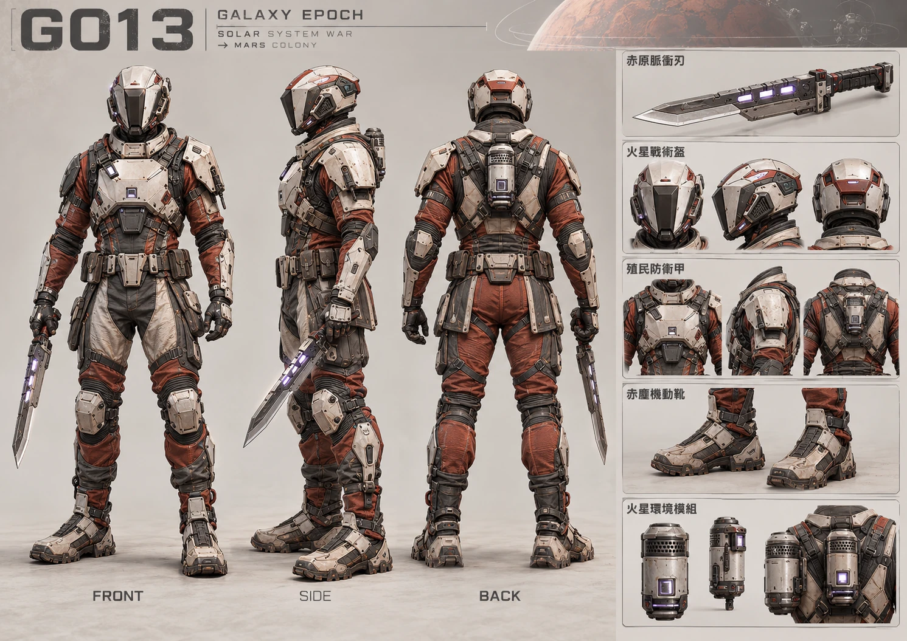

**equipment-five-slots.webp** — 1491 × 1055，331,162 bytes（331.162 KB）。

SHA-256：`899a87f369b21037818246e5a7fe94fcd04de3d3c4ab1b0e55c729c0ab80defa`

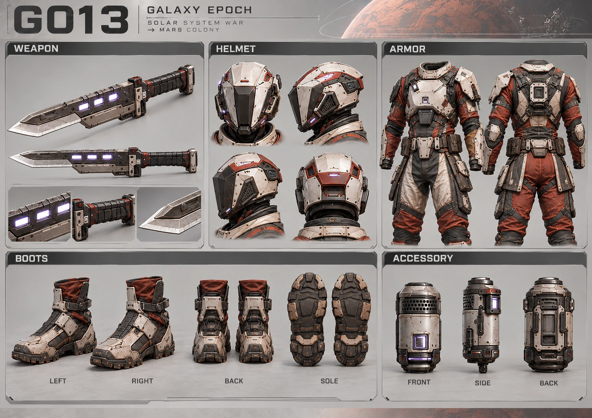

### G014｜太陽系戰爭 → 火星赤原戰場

待確認的美術方向：火星厚重斜面楔形裝甲、重刃、沙暴密封面罩與雙鏡火控模組。

**overview-front-side-back.webp** — 1491 × 1055，311,356 bytes（311.356 KB）。

SHA-256：`b366a95b47b1bc1ab55c0b4231df1a05d93ab0d4bcd07e04e4a03b784deec3f2`

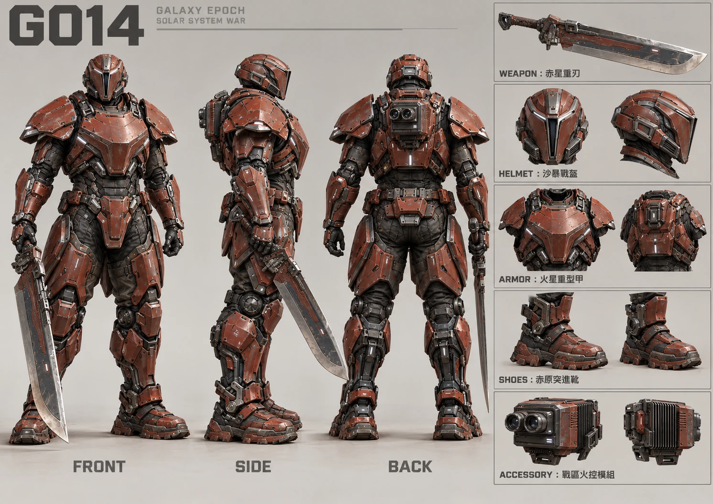

**equipment-five-slots.webp** — 1491 × 1055，309,736 bytes（309.736 KB）。

SHA-256：`956fb7158385058f3686ae6c15415bf928c0763b910eb784533d633093786078`

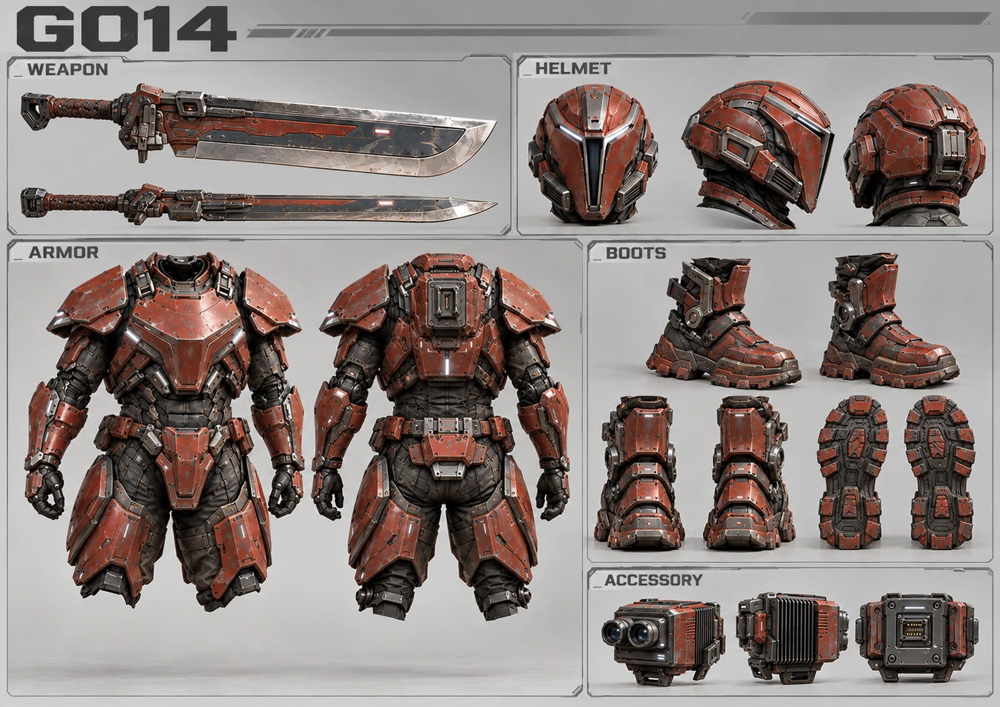

### G015｜太陽系戰爭 → 小行星採礦帶

待確認的美術方向：採礦承重外骨架、活塞震裂刃、工業重盔與扇形礦帶掃描器。

**overview-front-side-back.webp** — 1491 × 1055，377,854 bytes（377.854 KB）。

SHA-256：`7db6a6860becdb4dc6d1f8279579691a5eca87a78b620f56211821ea4a18cc94`

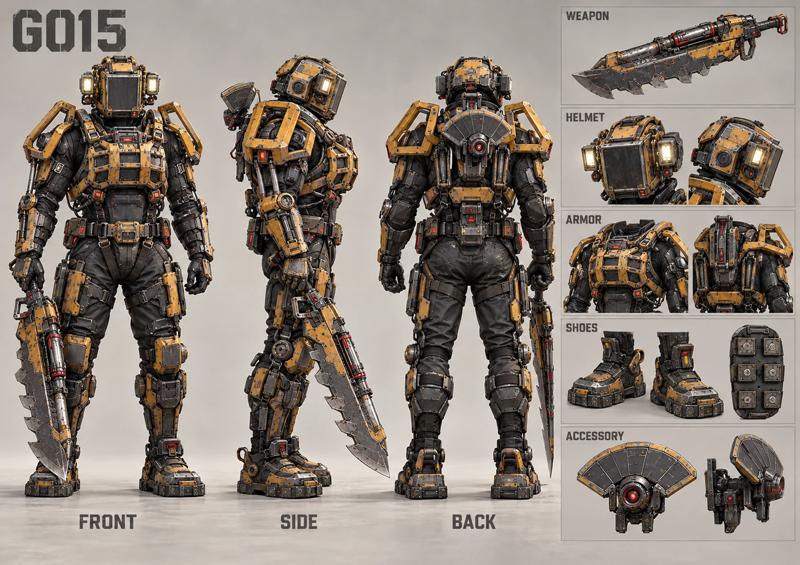

**equipment-five-slots.webp** — 1491 × 1055，387,978 bytes（387.978 KB）。

SHA-256：`1d0659d71c414eeab43211f45a037ea56c9b3a5e188dda2dd2616f5f5f98397d`

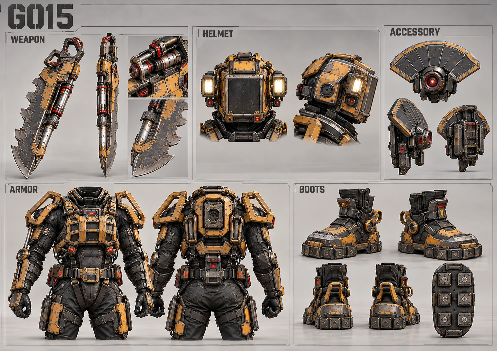

### G016｜太陽系戰爭 → 木衛戰區

待確認的美術方向：冰殼曲面層甲、低溫動力關節、冰面推進靴與三角座導航核。

**overview-front-side-back.webp** — 1491 × 1055，244,882 bytes（244.882 KB）。

SHA-256：`7239b312b4e3e5ba525d67f779154bf051817cf6832a25c93e7c4d9dcaf60cb6`

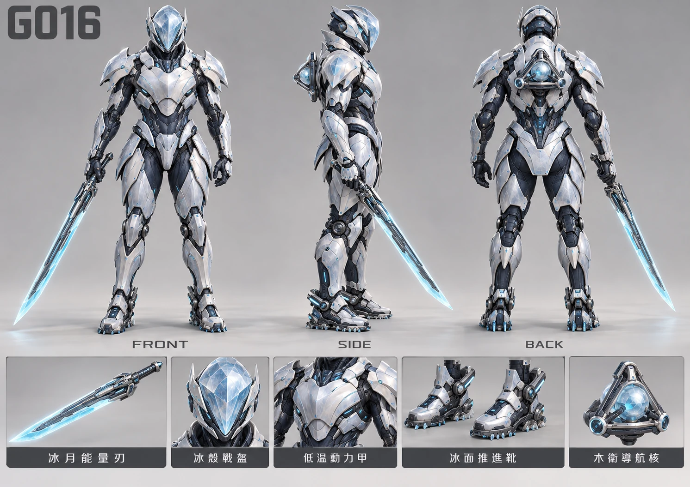

**equipment-five-slots.webp** — 1491 × 1055，293,564 bytes（293.564 KB）。

SHA-256：`b5eb3b7779615ce5f11771f8a4091174def09ba3a6bba021a65d68d5d9cba9a1`

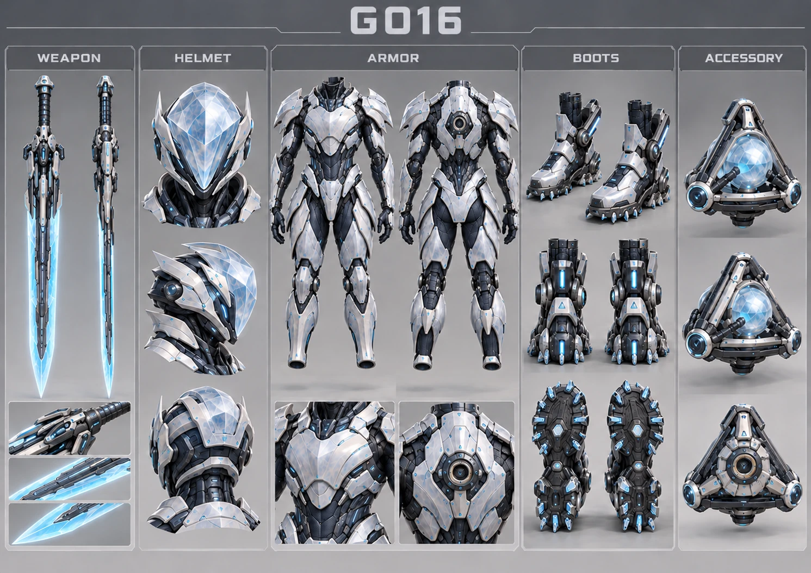

### G017｜太陽系戰爭 → 木星軌道圈

待確認的美術方向：高壓桶形約束帶、重力節點刃、引力修正鞋翼與陀螺框控制器。

**overview-front-side-back.webp** — 1491 × 1055，330,288 bytes（330.288 KB）。

SHA-256：`5588161b8b19f02fb84180a566d76c641ef2249531a6e2861c66f0538617a125`

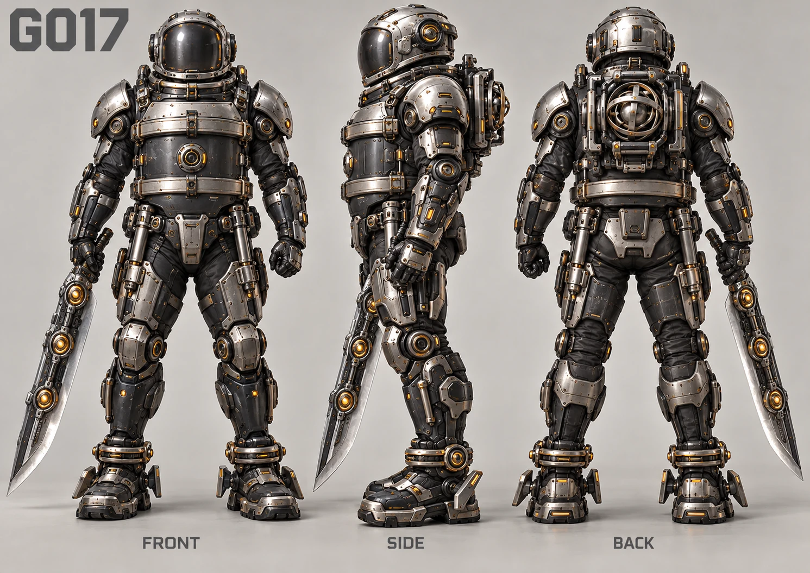

**equipment-five-slots.webp** — 1491 × 1055，336,194 bytes（336.194 KB）。

SHA-256：`60a670dcf3ea92bba37724a62cc59f48d369d3581bce8ee61bce0be83d973e41`

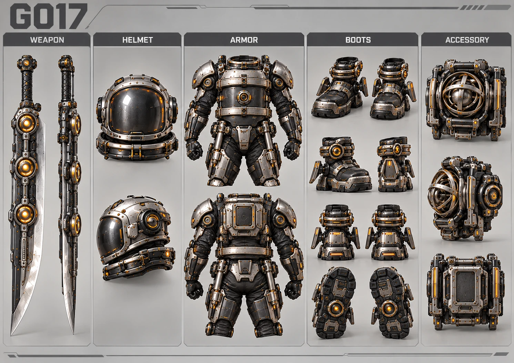

### G018｜太陽系戰爭 → 土星環防線

待確認的美術方向：碎冰掃掠層片、環帶光刃、機動鞋翼與橢圓土星環定位器。

**overview-front-side-back.webp** — 1491 × 1055，260,864 bytes（260.864 KB）。

SHA-256：`69850a7d5105e86f73c7a7d302eb0efea4ef634b9af69dd37b3f5e8cc5db02c3`

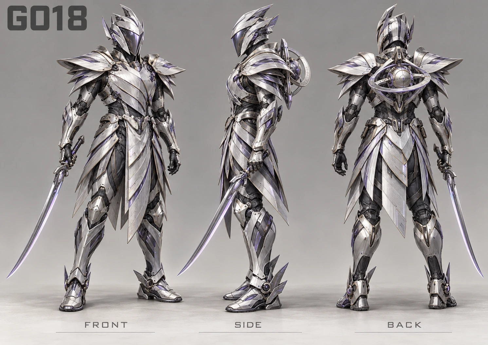

**equipment-five-slots.webp** — 1491 × 1055，273,190 bytes（273.190 KB）。

SHA-256：`fee3e8d93669609682cb3e839331ede9bb745d3e96b19a7b7c97ef9923269062`

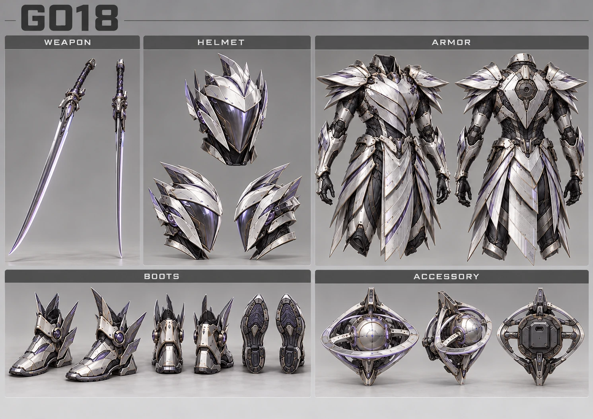

### G019｜太陽系戰爭 → 外太陽系邊境

待確認的美術方向：深空分叉保溫長衣、長程推進靴、切界刃與獨立航標天線。

**overview-front-side-back.webp** — 1491 × 1055，229,056 bytes（229.056 KB）。

SHA-256：`2877d42e51da3bbb8f18db21a964711dc2fa4eb01d90bd4eb94432aaee588968`

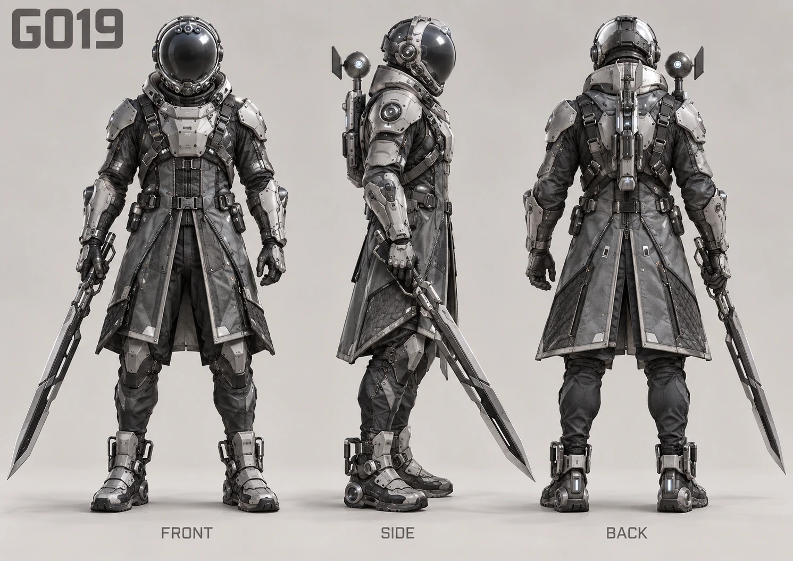

**equipment-five-slots.webp** — 1491 × 1055，253,668 bytes（253.668 KB）。

SHA-256：`317aa6e5702152e0e9fe8ac4915d1d3418a86bf9eac11fad90c86ef7a0afae1f`

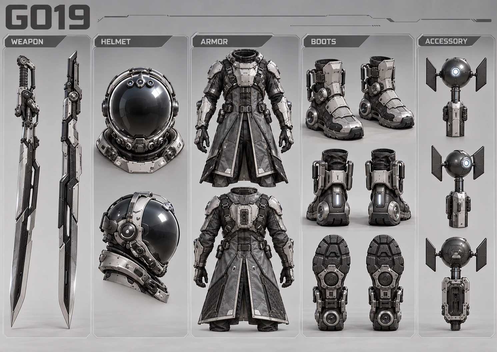

### G020｜太陽系戰爭 → 太陽系終極戰線

待確認的美術方向：恆星散熱鰭肩甲、日耀刃、躍遷環鞋踝與六角主控核心。

**overview-front-side-back.webp** — 1492 × 1054，329,654 bytes（329.654 KB）。

SHA-256：`be74681baa90b1cd1eaa80bab2777f8bfe1fe0a2f1a234c3182c1b11b0605d9c`

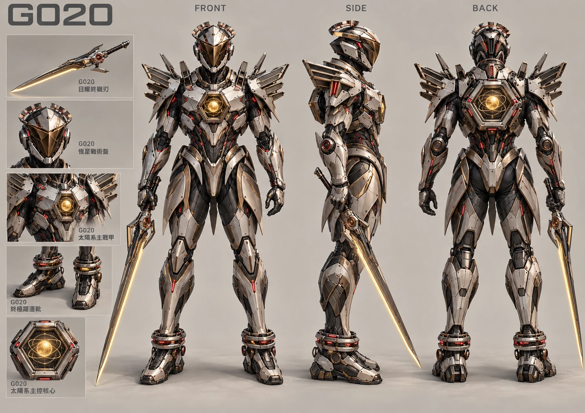

**equipment-five-slots.webp** — 1491 × 1055，312,418 bytes（312.418 KB）。

SHA-256：`ad91922ed12174edd81e2071a4682915b14370c269ebdadba50a5191ce0d86e0`

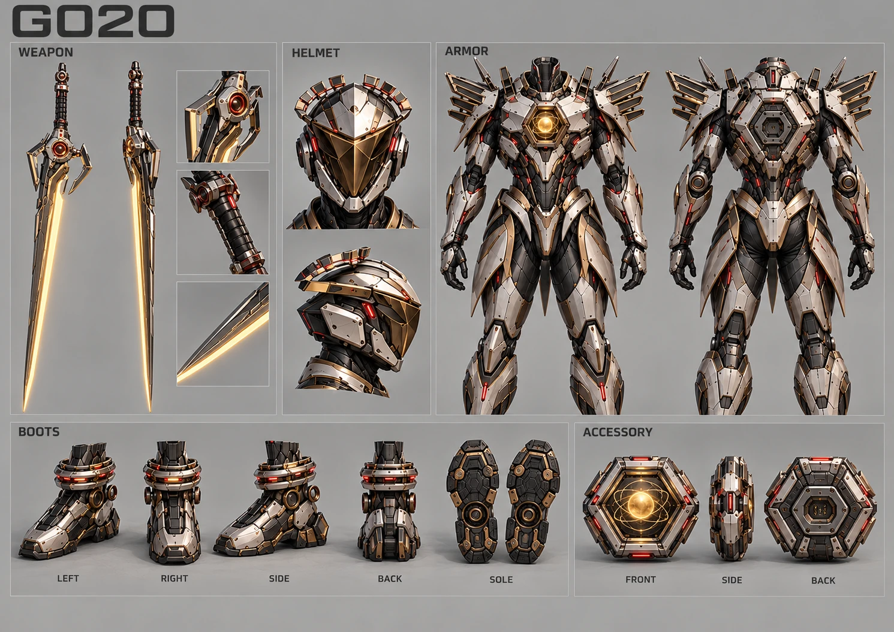

## 自我檢查與使用者複核

- 本批 20 張實際 WebP 合計 5,937,324 bytes（5.937324 MB），各張皆低於 800 KB；沒有調整玩家發布清單。
- generate／validate 通過；100／100／10 套、1,050 槽映射保持不變，40 張既有＋新圖，20 套有兩圖，批准零。
- unittest 27 項通過；G02 status 為 20 張／缺零，plan 無輸出。docs-integrity、B18 coverage、equipment-contract 通過。批次測試將過期「G02 固定缺 20 張」改為逐檔核對存在與缺少集合，保留漂移拒絕與禁止重畫檢查。
- 提交前另核對再 generate 零差異、G001～G010 原圖／notes 完整保護、其他 200 套索引不變，以及 publish-asset-audit 正式資產排除。實際 CI 結果以本提交的 Actions 為準，未完成前不宣稱全綠。
- 使用者需審閱十套輪廓區別、全遮臉、武器與拆解一致性、飾品大小／單一掛载、雙鞋與鎧甲分離，以及概念美術是否符合正式名稱。細部接口與正側背尺寸仍可能需要批准後工程修訂。
- 下一批 B02／管理 G03 為 G021～G030，尚未製圖；續跑先 validate、status、plan --batch G03。

## 提交前 main 更新承接

施工期間 main 新增轉型草案兩筆提交；提交前重新讀取 `c52884a271e943b1d89744ee5f7854d1e1f53152` 與混合式轉型草案，確認概念圖量產繼續、現行契約有效。保留這兩筆更新及交接內容，再整合 B01；未施工轉型草案。
