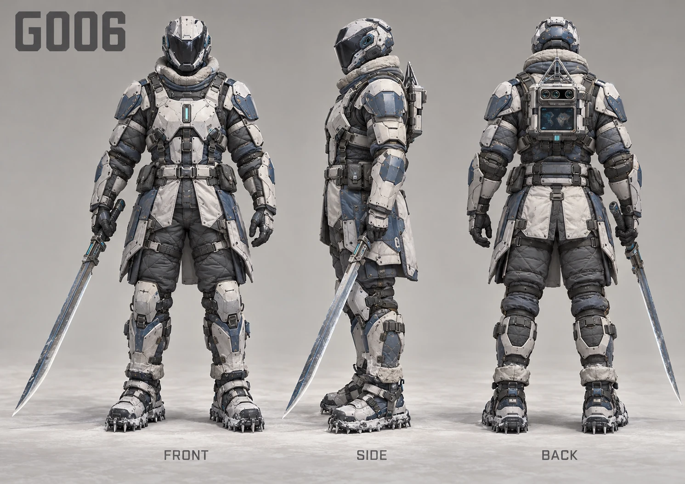
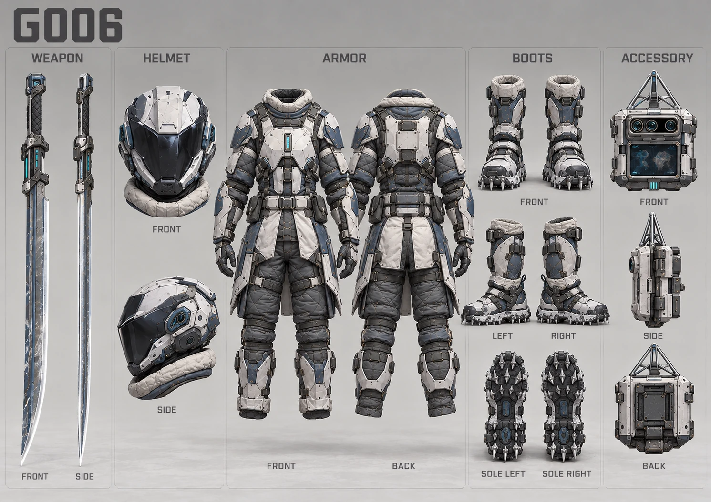
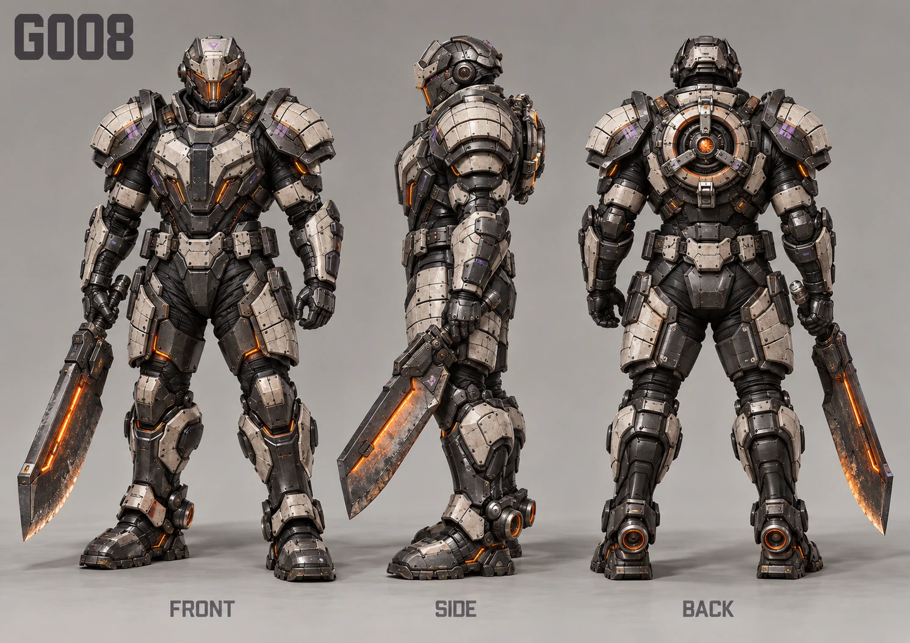
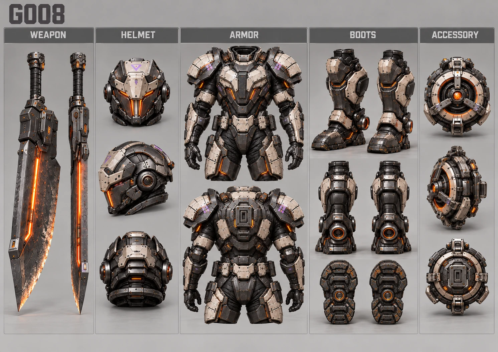
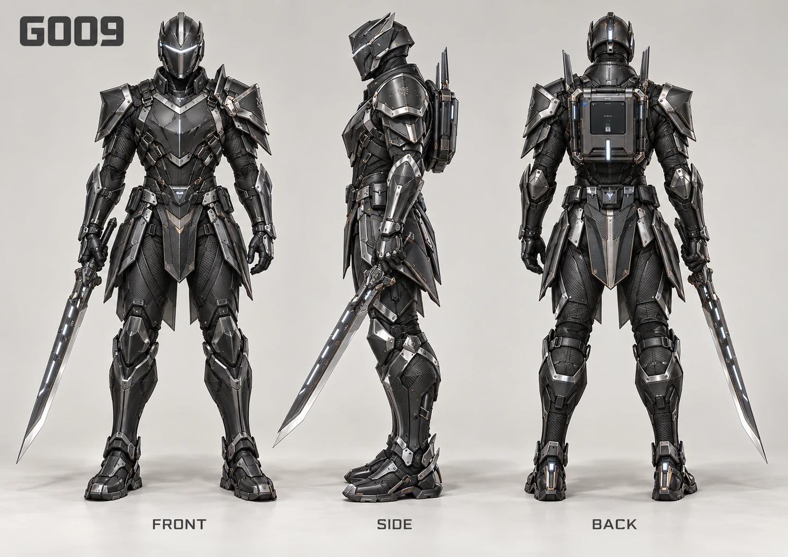
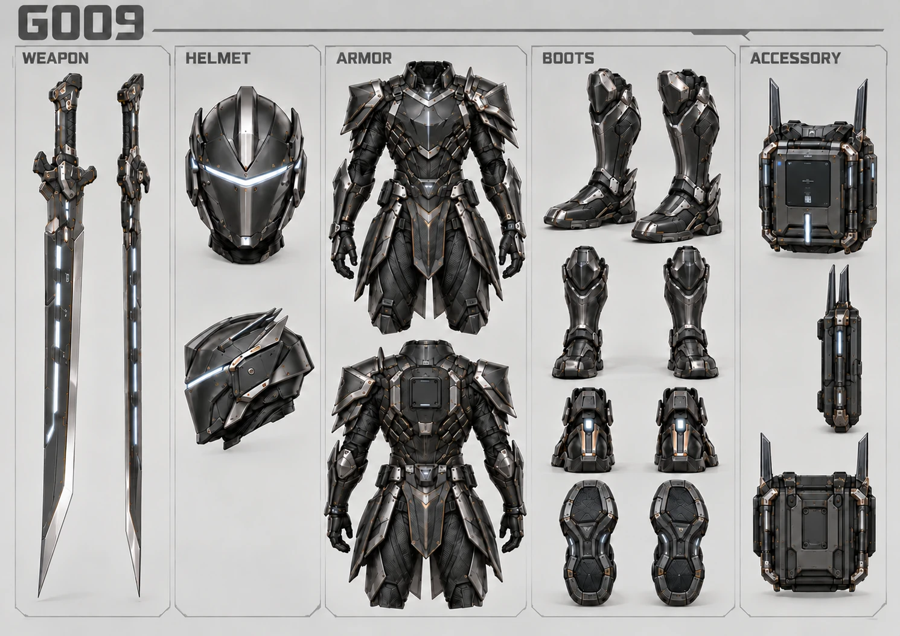
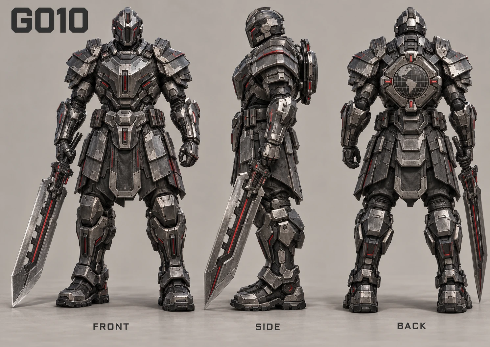
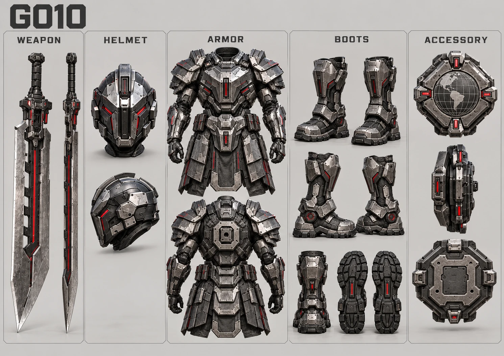

# 批次 A｜G006／G008／G009／G010 概念圖施工紀錄

起始 main：`1dfd91e100a625eb0b2314f90063a301bccdcd6d`。製圖前以正式 owner 抽取結果逐套核對 notes／索引，一致，未改正式名稱。

## 製圖前正式名稱核對

| ID | 正式區域 | 等級 | weapon | helmet | armor | shoes | accessory | 正式來源 |
| --- | --- | --- | --- | --- | --- | --- | --- | --- |
| G006 | 地球戰爭 → 極地戰線 | Lv.26～30 | 霜鋼長刃 | 極寒封閉盔 | 冰原保溫甲 | 雪地抓地靴 | 熱源定位器 | worldmaps-earth.js:8 / EARTH_MAPS[5].gear |
| G008 | 地球戰爭 → 火山兵器基地 | Lv.36～40 | 熔蝕重刃 | 高熱隔離盔 | 熔核耐熱甲 | 熱區推進靴 | 反應爐調節器 | worldmaps-earth.js:10 / EARTH_MAPS[7].gear |
| G009 | 地球戰爭 → 全球指揮中心 | Lv.41～45 | 禁衛脈衝刃 | 中樞禁衛盔 | 指揮級複合甲 | 戰略機動靴 | 戰場指揮模組 | worldmaps-earth.js:11 / EARTH_MAPS[8].gear |
| G010 | 地球戰爭 → 地球決戰區 | Lv.46～50 | 終戰斷界刃 | 終戰主控盔 | 征服者重甲 | 最終突擊靴 | 地球主控權限 | worldmaps-earth.js:12 / EARTH_MAPS[9].gear |

來源註冊：data.js WORLD_REGIONS / registerRegionMaps；五槽順序：engine.js EQUIPMENT_TYPES / makeItem。已有 G001～G005、G007 本次全部保留。

## 美術與製圖結果

實際影像生成工具成功產出四套正側背及四套參考原三視圖的五槽拆解圖。G009 飾品側視首稿有額外頭盔形體，首次修正未成功，第二次重畫該側視才移除；共 10 次工具呼叫，八張最終 WebP 入庫。所有原稿與修正稿保留於執行環境 `/workspace/generated_images/`，不是 GitHub 無損原稿備份。全部待審，不能推定使用者批准。


| ID | 獨有輪廓與名稱對應 |
| --- | --- |
| G006 | 冰原保溫甲採厚織層、保溫裙片與霜鋼護板；長刃、全封閉盔、抓地齒雙靴與三孔感測熱源定位器表達極地環境。 |
| G008 | 熔核耐熱甲採厚重陶瓷分層與隔熱間隙；寬厚熱刃、封閉隔熱面甲、腳踝推進器與環形三輻反應爐調節器表達高熱作業。 |
| G009 | 指揮級複合甲採收腰盾形胸板與禁衛肩甲；脈衝刃、封閉感測面甲、機動穩定雙靴與雙天線指揮模組表達全球指揮。 |
| G010 | 征服者重甲採階梯式肩堡與厚重腰腿護板；長型斷界重刃、封閉主控盔、突擊減震雙靴與地球網格權限模組表達決戰重裝。 |

共享機能布料、實體護板、柔性關節與少量能源指示語言；輪廓和機構不同，不只是換色。G001～G005 及 G007 的整套目錄（含 notes、原圖）已逐檔對起始 main 比較，位元內容不變；非本批 206 筆索引亦不變。

## 最終圖片與指紋

Pillow 僅做 RGB/WebP 格式轉換，quality=90、method=6，不改繪內容。八張皆 1491×1055、可完整解碼，總計 2196362 bytes；沒有超過 800 KB。部分低於 300 KB，完整尺寸下主要材質與裝備輪廓仍清楚。

### G006

[overview-front-side-back.webp](../development/3d-source/equipment/concepts/galaxy/g006-polar-front/overview-front-side-back.webp) — 248964 bytes；SHA-256：`4d9276295c27cd9ade7a4e064255f5e5a961967ba680b773e16a175bcc7688cd`。



[equipment-five-slots.webp](../development/3d-source/equipment/concepts/galaxy/g006-polar-front/equipment-five-slots.webp) — 277736 bytes；SHA-256：`1d84fa4d7c284f4266eb6cff0dddbcdb9f6eb35aedf5322f1786859a751601ce`。




### G008

[overview-front-side-back.webp](../development/3d-source/equipment/concepts/galaxy/g008-volcanic-weapons/overview-front-side-back.webp) — 298646 bytes；SHA-256：`5d3dec09b6a0259b42a7fbb2aee9dfb512f75a6e2984d13a5bf7f8bc3761d975`。



[equipment-five-slots.webp](../development/3d-source/equipment/concepts/galaxy/g008-volcanic-weapons/equipment-five-slots.webp) — 321186 bytes；SHA-256：`1ca2a6449af8240f5cfcc478db46a2af6c1882de5bcda3185dba2f7323a163bc`。




### G009

[overview-front-side-back.webp](../development/3d-source/equipment/concepts/galaxy/g009-global-command/overview-front-side-back.webp) — 239930 bytes；SHA-256：`51b4485dbc14e71bc172edbf26000ce3edf8a3d9058aa9249dcb409bdb529948`。



[equipment-five-slots.webp](../development/3d-source/equipment/concepts/galaxy/g009-global-command/equipment-five-slots.webp) — 220084 bytes；SHA-256：`ebf438c5c75dfc2cbad70cda71991281ff727777306e89f93c95becb253605f5`。




### G010

[overview-front-side-back.webp](../development/3d-source/equipment/concepts/galaxy/g010-earth-final-battle/overview-front-side-back.webp) — 295298 bytes；SHA-256：`407f2d57cb6b074e4f2d9f550121fc2710fcfde43dad8913b354cccb8929e6f8`。



[equipment-five-slots.webp](../development/3d-source/equipment/concepts/galaxy/g010-earth-final-battle/equipment-five-slots.webp) — 294518 bytes；SHA-256：`c5684aae47af5123f8b19940b6b2915b5aeb4b2cce01aac71a2496f246dc53ce`。



## 狀態與必要驗證

G001～G010 現有 20 張圖，十套均待審、conceptApproved=false；其餘 200 套沒有圖。本批四套 modelStatus=not-started。G007 舊模型證據不變，不代表已批准或已依新概念圖重製。

```bash
python3 scripts/equipment-concepts.py generate
python3 scripts/equipment-concepts.py validate
python3 -m unittest discover -s tests/equipment-concepts -v
node tests/runtime/docs-integrity.js
node scripts/publish-asset-audit.cjs
```

五項指定指令全部通過，22 個 unittest 通過；再次 generate 的 changedFiles=0，追蹤檔案零差異。發布 audit hardMissing=[]，379 個選取來源檔案皆無概念圖，選取來源容量仍為 36.463599 MB（靜態來源估計，非本次網站成品容量）。缺圖誤標批准的負向測試，改為依實際索引選取仍無圖套裝，維持原本拒絕斷言，避免 G006 補圖後測試身份不符；沒有停用或放寬重要驗證。既有產生器、狀態衍生及發布政策沿用。

未變更正式遊戲、音訊、存檔、Blender、GLB、LOD、registry、快取、Pages 發布來源或資產清單。本批概念圖必須全部在發布選取清單之外。CI 結果以最終 SHA 的 Actions 為準。

## 使用者待審

請逐套確認五槽名稱的造型表達、全遮臉、成對鞋子、三視圖與拆解圖一致性，以及縮小後辨識度。概念圖並非精準工程圖：護頸的歸槽邊界、細接縫和跨視圖精確尺寸仍需批准後再規劃；本批不進行模型施工。未收到使用者明確批准前，不建立 art-review 批准證據。
