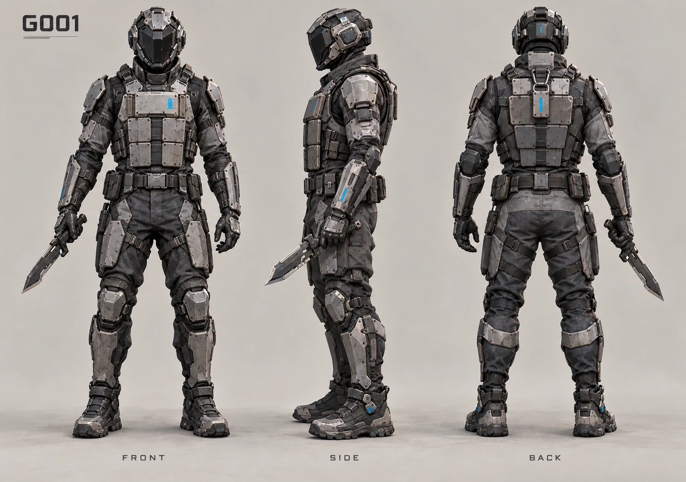
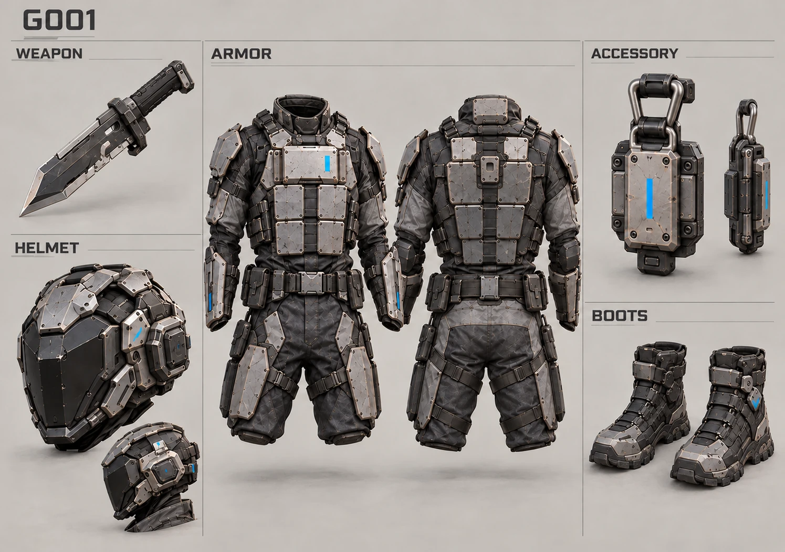
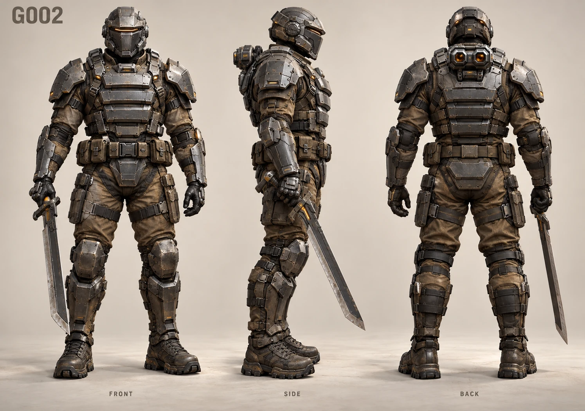
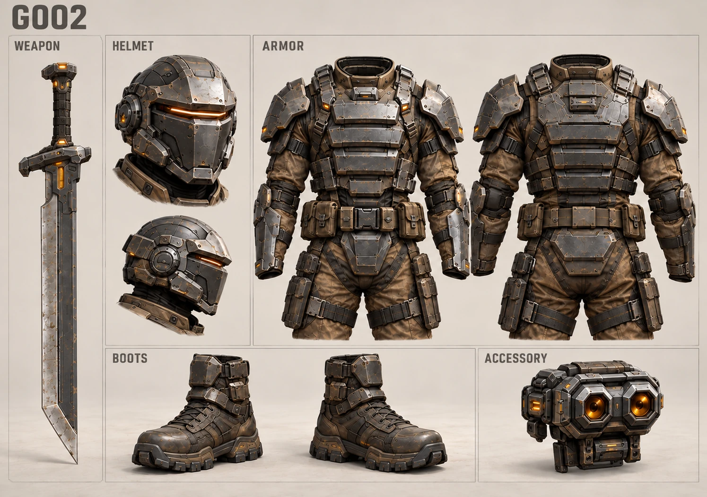
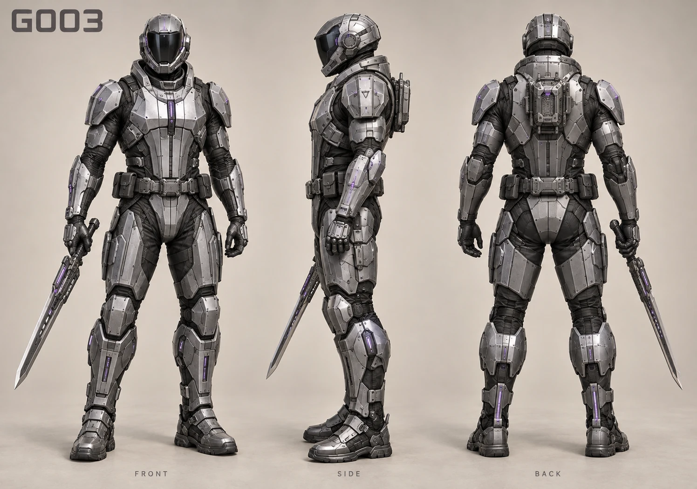
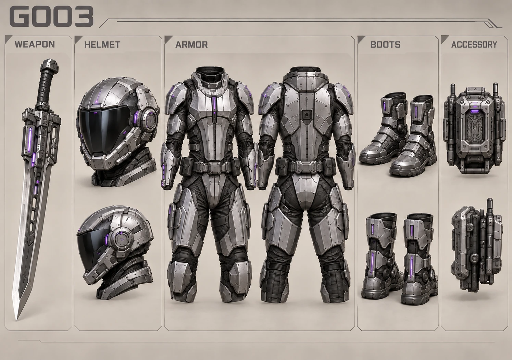
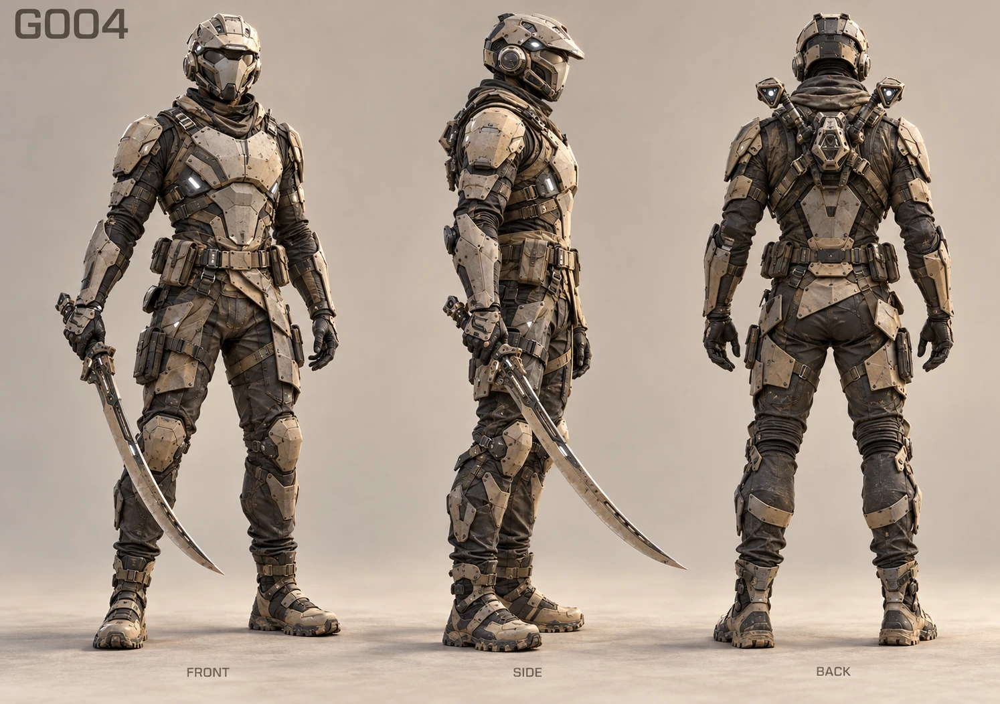
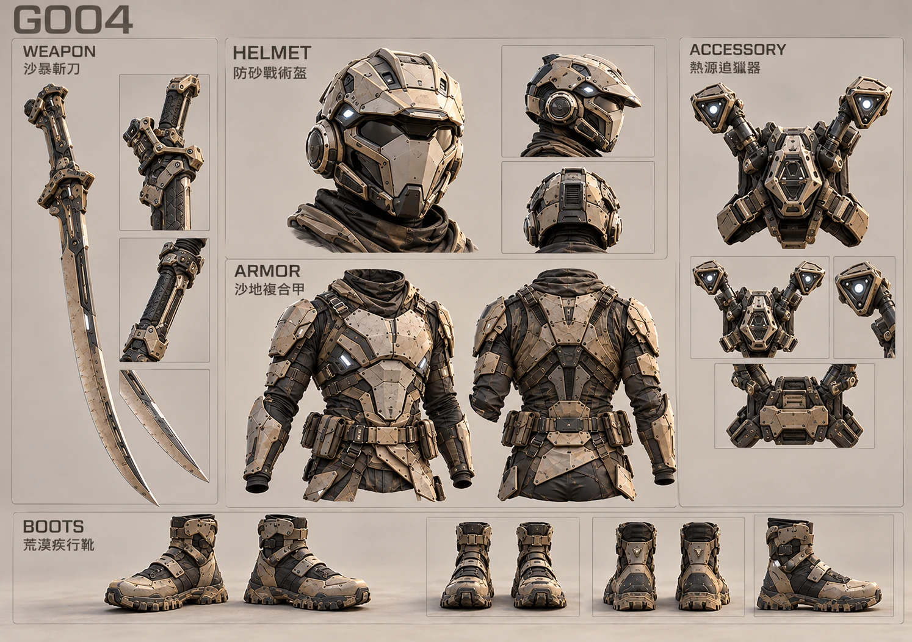
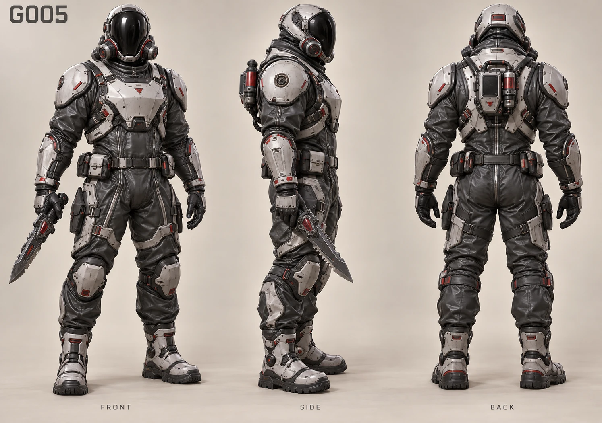
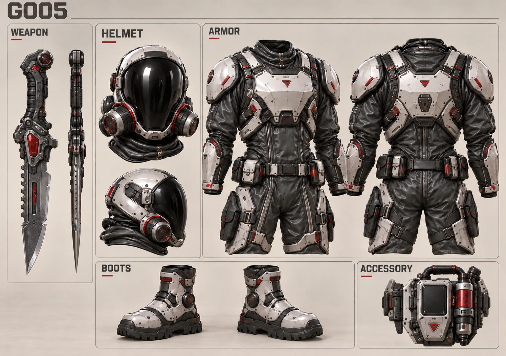

# G001～G005 概念圖流程試跑｜2026-10-11

起始 main：`38ce80f1087656ea5dac0b563b2cc5b76ab05add`。正式身份與五槽名稱由當前程式及概念資料庫核對；僅銀河紀元 → 地球戰爭前五套。

## 實際流程與結果

使用本次環境可用的 image_gen：5 次正側背生成、5 次以各套正側背圖為參考的五槽生成，以及 4 次局部修正，共 14 次成功呼叫；最終保留 10 張待審圖。初稿 G001/G002/G003/G005 的鎧甲背面重複附掛飾品，已用影像編輯器移除，保留獨立飾品與空掛接位置。原始 PNG 保留於執行環境 `/workspace/generated_images/`，GitHub 只入庫標準 WebP，非原始 PNG 長期備份。

Pillow 僅做 RGB/WebP 格式轉換：quality=90、method=6，未改繪內容。概念圖不是模型工程驗證；圖中文字不取代正式 notes。所有頭盔遮面、雙靴成對、五槽拆解已人工目視檢查，但跨視角精確比例、接縫與掛接尺寸仍需使用者美術審閱及後續建模確認。

## 五套正式身份與設計差異

### G001｜地球戰爭 → 城市淪陷區

{'kind': 'region-range', 'min': 1, 'max': 5}

正式五槽：破門短刃／巷戰防護盔／城防插板甲／街區突進靴／戰場識別牌

待確認的美術方向：緊湊方形插板與短厚破門刃；青藍小面積識別光，城市巷戰輪廓。

[overview-front-side-back.webp](../development/3d-source/equipment/concepts/galaxy/g001-fallen-city/overview-front-side-back.webp) — 1495×1052，218994 bytes（219.0 KB）。

SHA-256：`97aef696fce7b1754839f5f469ab9ac051cb1e678d990139ff5c058e96d92184`



[equipment-five-slots.webp](../development/3d-source/equipment/concepts/galaxy/g001-fallen-city/equipment-five-slots.webp) — 1495×1052，235752 bytes（235.8 KB）。

SHA-256：`b325ec1a0fe01da367cf92883c79b6bcf350da980e55db79d7b686f87d59c139`



### G002｜地球戰爭 → 郊區防衛線

{'kind': 'region-range', 'min': 6, 'max': 10}

正式五槽：壕溝軍刀／哨戒戰盔／防線重甲／越野作戰靴／前線測距儀

待確認的美術方向：厚重橫向防線護板、軍用布料與直軍刀；琥珀測距模組，外張重裝輪廓。

[overview-front-side-back.webp](../development/3d-source/equipment/concepts/galaxy/g002-suburban-defense/overview-front-side-back.webp) — 1495×1052，261866 bytes（261.9 KB）。

SHA-256：`ac69b16d73368dc16bfeb6d8b45a0ac229963ae66a51fe89cba7235a34365510`



[equipment-five-slots.webp](../development/3d-source/equipment/concepts/galaxy/g002-suburban-defense/equipment-five-slots.webp) — 1495×1052，274886 bytes（274.9 KB）。

SHA-256：`3325ceb1ff3b234778c0e601ce0c5c9d00a968a31b5ce5b457900de86bf61510`



### G003｜地球戰爭 → 地下軍事設施

{'kind': 'region-range', 'min': 11, 'max': 15}

正式五槽：試作振動刃／地堡密封盔／實驗型護甲／封鎖區戰靴／軍規解碼器

待確認的美術方向：精密縱向肋板、銀紫實驗護甲與振動刃致動器；密封地堡盔和解碼器。

[overview-front-side-back.webp](../development/3d-source/equipment/concepts/galaxy/g003-underground-military/overview-front-side-back.webp) — 1496×1051，221198 bytes（221.2 KB）。

SHA-256：`035df705ff62e46722740ad02dc5f888f88ad7bf9102a3288b678b31c7828525`



[equipment-five-slots.webp](../development/3d-source/equipment/concepts/galaxy/g003-underground-military/equipment-five-slots.webp) — 1495×1052，229566 bytes（229.6 KB）。

SHA-256：`b3aeb221c3164b7d914748a4094aa71a3c9a258f47a7a18398a8ae1f9bcfc480`



### G004｜地球戰爭 → 荒漠戰區

{'kind': 'region-range', 'min': 16, 'max': 20}

正式五槽：沙暴斬刀／防砂戰術盔／沙地複合甲／荒漠疾行靴／熱源追獵器

待確認的美術方向：斜向沙地複合板、耐砂布料、弧形斬刀與 V 形熱源感測模組；輕捷輪廓。

[overview-front-side-back.webp](../development/3d-source/equipment/concepts/galaxy/g004-desert-warzone/overview-front-side-back.webp) — 1494×1052，239094 bytes（239.1 KB）。

SHA-256：`914c0660395cb60f13cd013d05a2bffa306a36843928bd20b13abb22167b9295`



[equipment-five-slots.webp](../development/3d-source/equipment/concepts/galaxy/g004-desert-warzone/equipment-five-slots.webp) — 1494×1052，315710 bytes（315.7 KB）。

SHA-256：`6bee8e939ace7865b8a92abd71dff0e91d71f649e93034c07516b66047ce48eb`



### G005｜地球戰爭 → 污染禁區

{'kind': 'region-range', 'min': 21, 'max': 25}

正式五槽：蝕毒軍刃／全罩防化面盔／生化隔離甲／污染區封閉靴／異變偵測器

待確認的美術方向：圓弧隔離護板、橡膠密封接縫、雙側濾罐與紅色樣本偵測模組；防化輪廓。

[overview-front-side-back.webp](../development/3d-source/equipment/concepts/galaxy/g005-contaminated-exclusion/overview-front-side-back.webp) — 1494×1052，228040 bytes（228.0 KB）。

SHA-256：`f3cfb23f7b04d5edd8d1d06aa59a302b9cf0ff15323077e17c68685b7691f055`



[equipment-five-slots.webp](../development/3d-source/equipment/concepts/galaxy/g005-contaminated-exclusion/equipment-five-slots.webp) — 1495×1052，269020 bytes（269.0 KB）。

SHA-256：`902c80ac9d20bca96397916c34a7080a4a408e19da0f02f4c76e88b07c06e940`



## 狀態、驗證與範圍

10 張合計 2494126 bytes；每張 219～316 KB，小於建議 300～800 KB 的部分仍可清楚辨識主要材質與輪廓。沒有超過 800 KB。現有 G007 兩張圖片與 notes 原樣保留。共 6 套有兩圖、204 套尚無圖；批准數仍為 0。新五套全部 images-present-awaiting-user-review／conceptApproved=false／modelStatus=not-started。

實際執行：

```bash
python3 scripts/equipment-concepts.py generate
python3 scripts/equipment-concepts.py validate
python3 -m unittest discover -s tests/equipment-concepts -v
node tests/runtime/docs-integrity.js
node scripts/publish-asset-audit.cjs
```

Generate/validate 通過；22 個 unittest 通過，包含重跑零差異、G007 保護、人工內容保留、名稱／身份錯誤、批准證據與同圖冒充兩圖的負向檢查。既有測試的「僅一套有圖片」改為逐套核對真實檔案及衍生狀態，沒有移除名稱或批准驗證。Docs integrity 通過；發布 audit 通過，hardMissing=[]，379 個選取來源檔案均無概念路徑。稽核的 36.463599 MB 是來源選取估計，本次未建置或宣稱新的網站成品容量。

沒有修改正式遊戲、音訊、存檔、Blender、GLB、registry、Service Worker、Pages 資產清單或發布設定。概念圖片仍屬開發排除資產。CI 實際結果以最終 SHA 對應 Actions 為準。

## 是否適合繼續批次生產

本次證明：搭配此環境實際提供的影像生成工具，Codex 能完成來源核對、生成、參考圖一致性、局部修正、壓縮入庫和狀態驗證。不能推論沒有影像工具的 Codex 環境也能生成圖片。建議先由使用者審閱這五套，再採小批次生產；圖像品質需要目視檢查，檔案檢查通過不代表美術批准。下一步只需審核輪廓差異、全遮臉、五槽一致性與建模可讀性，退件後修圖；未批准前不得建模或整合。
