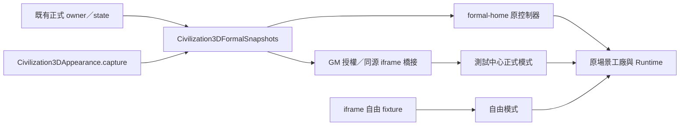

# 混合式轉型 T1-A：正式唯讀資料契約施工與驗收

起始 main：`4ae7793a13e49b14229da48fcb249aa9b1c7c198`。程式提交：`c9d11c2596dc8da49bbc81a557f92199d504782d`。本批限共用資料解析；不表示混合式產品選型定案、不授權後續 T1-B／T1-C。

## 實作與相容

新增 `3d-test/formal-snapshots.js` 的 `Civilization3DFormalSnapshots` version 1。函式每次解析目前 runtime owner，公開回傳值 JSON 深複製，避免 renderer／GM 改到正式物件。沒有 DOM、儲存、交易、fixture、資產 loader 或新事件 owner。

修改前：`formal-home.js`／`gm3dprototype.js` 各自解析正式地圖、災厄、副本及戰鬥。修改後：兩者呼叫共用快照，再交給原場景工廠；GM 自由資料仍只存在 iframe 的測試 fixture。所有原公開外部 API、場景工廠、按鈕及授權入口保留。`Civilization3DAppearance.capture()`／`scene()` 不改；共用層只是呼叫及複製其結果，仍支援混紀元五槽與空槽。

## 逐項正式來源

| 快照 | 真正正式來源／語意 |
|---|---|
| appearance | 原 `appearance-snapshot.js` capture；不改人物、五槽 resolver 或 GLB |
| equipmentCatalog | `MAPS`／`WORLD_REGIONS`、`secondWorldBoss()`、`THIRD_WORLD_EQUIPMENT_NAME_ROWS`；100／100／10 套、1,050 正式名稱 |
| galaxy | `worldmapui.js` 的 `regionCleared`：末地圖 Boss 已擊殺，或 unlockedMap 超過 mapEnd。engine 最大解鎖 99，故不能用 101／501 判最後大區完成 |
| galaxy review | 正式選取 `getGalaxyReviewSelectedMap()`、review context；GM 主線仍明確採最高解鎖焦點，而非強迫等同正式目前選取 |
| universe／review | `secondWorldBossKilled()`、`secondWorldHighestUnlockedBossIndex()`、正式目前區域 getter；review 只改呈現 context |
| higher | 每次呼叫目前全域 `thirdWorldBossProgressSnapshot(index,state)`，保留轉生後覆寫，不快取舊 owner |
| growth | 原專精、印記、文明及核心欄位的視覺投影；不改養成公式 |
| calamities | 正式 definitions／status／unlock／visible；保留回顧旗標；缺資料的每列 status=unavailable |
| alternate | `alternateUniverseProgressionSnapshot()`、`alternateUniverseActiveAttempt()`、`alternateUniverseFailureStatus()`；activeAttemptDepth、nextChallengeDepth、historicalCompletedDepth 分離。焦點優先 active，其次 next，僅完全通關時回顧歷史末層 |
| dungeon | 現行 bounty／arena／mirror／void owners、mode policy、正式解鎖及每日剩餘；高維沒有懸賞。hub 可用性保持工廠使用的 bounty／arena／tower／mirror 四項固定索引 |
| battle | 原 `getCombatPresentationSnapshot()` 的 HP／盾；拒絕不合法數值。特殊遭遇與結算無可靠快照，`encounterAvailable=false`／`settlementAvailable=false`，附 unavailable reason |
| 劇情／紀錄／轉生展示 | 既有 kind／visualOnly 路由 metadata 保持，不冒充新增正式劇情或結算資料；回顧地圖使用上述正式 owner |

GM bridge 的 state.gm、origin、iframe contentWindow、關閉後拒絕及非同步外觀回覆前再次授權檢查均保留。正式來源缺失不補成自由 fixture；中心增加同源 scenario-error 與 unavailable 顯示。

## 修改範圍

- 正式共用／轉接：`3d-test/formal-snapshots.js`、`3d-test/formal-home.js`、`gm3dprototype.js`、`3d-test/test-center.js`。
- 版本：`index.html`、`3d-test/index.html`、`resource-manifest.json`。新解析模組小型同步載入，不同步載入 Babylon／GLB／外觀；SW 及發布資產規則未改。
- 測試：`tests/runtime/3d-formal-snapshots-contract.cjs`、`3d-formal-snapshots-browser.js`、`3d-b18-coverage-guard.js`。原 guard 正式來源斷言移至共同 owner，補行為／負向測試，未停用重要斷言。
- CI：Runtime Integrity、Publish Release Gate、Publish Optimized Pages 新增同一契約及瀏覽器測試；既有發布來源不切換。
- 交接：本報告、PROJECT_HANDOFF、路線圖 T1-A 單列狀態；原第 27～40 批規格不改。

## 實際驗證紀錄

施工中確認通過：

- `node tests/runtime/3d-formal-snapshots-contract.cjs`：15 項，全通過；缺 owner、非有限 HP／盾、錯 origin／iframe／未授權、空槽／混穿、回傳資料不共享引用、正式名稱映射。
- `node tests/runtime/js-integrity.js`、`3d-b18-coverage-guard.js`、`resource-manifest-integrity.js`、`docs-integrity.js`。
- 既有 save-global-writers／newstate-save-owner、GM authorization／偏好／早期還原與異宇宙 data／attempt／combat／failure／progression／UI／migration 契約。
- `3d-equipment-contract.cjs`、`3d-batch28-preflight.cjs`、`3d-asset-registry-integrity.cjs`；18 個 GLB Khronos 驗證零 error／warning，53 骨／9 掛點與資產身份未改。
- resource-cache integrity／behavior／prefetch；32 背景、6 音樂＋11 音效，不預載模型；audio lifecycle 20 項、regression 9 項。
- `python3 -B scripts/equipment-concepts.py validate`：210 套／1,050 槽、20 套 40 圖、批准零；所有概念與模型未改。
- 原 startup-readiness-browser、galaxy-3d-button-browser、gm-3d-test-center-browser、code-cleanup-batch7-lazy-loading：通過。
- `save-load-pipeline-integrity.js`：來源網站及精簡候選均實際通過 Schema16→17、原始備份保留、fail-closed。起始 SHA 的 Pages run 38177024544 有 pendingSettlement 斷言失敗，保留其日誌記錄；本批沒有修改存檔／離線 owner 或該測試，不能將那次失敗宣稱已修復。
- `publish-asset-audit.cjs`、`build-publish-dry-run.cjs`、`publish-build-regression.cjs`：實際候選 382 檔，missingRefs=0；新增契約包含於原閉包，沒有把概念圖／開發原始工程加入玩家資產。

新 browser 使用隔離 SDK 帳號 fixture，走正式啟動、GM 授權 owner、劇情及領裝按鈕，不使用真帳號／雲端寫入，不隱藏啟動遮罩。僅固定 Date.now，保留原生 timer／animation frame／Date 建構，以免既有每 60 秒離線 heartbeat 時間戳污染完整 state 前後比較；不忽略任何 state 欄位。

人物與裝備的精簡候選完整 browser 回歸已通過：`3d-player-assets-browser.js`／`3d-equipment-assets-browser.js`，涵蓋正式／GM、53 骨、五槽、三 LOD、遮面、冷熱載入、故障與釋放。

`PLAYWRIGHT_BROWSERS_PATH=/tmp/rpg-t1-browsers RUNTIME_SMOKE_URL=http://127.0.0.1:4188/index.html node tests/runtime/3d-formal-snapshots-browser.js`：精簡成品 1280×800／390×844 各十個正式入口、實際場景與貼圖 ready、開啟／關閉、完整玩家 state 不變、GM 正式橋接一致及自由 fixture 隔離全部通過。沒有 pageerror。

來源 manifest 487／成品 manifest 375 個實際 SHA 均逐檔核對一致；HTML version guard self-test 通過。

提交後 exact-HEAD Actions 尚待執行；最後實際結果以 GitHub Actions 與交付回報為準，不將未完成工作標綠。

## 玩家待驗與後續界線

真 iPhone／桌機正式帳號：三紀元／回顧／災厄／異宇宙活動與歷史焦點；五槽混穿及空槽；所有正式預覽開關／重開／最大化還原；GM 正式同步、自由模式與關閉返回；背景／倍速與音訊保持原行為。真帳號／雲端、手機 Safari／GPU／弱網尚未自動完成，不對正式雲端做覆蓋或刪除測試。

T1-B 未開始：DOM 副本卡片篩選、Observer／預熱／loader／manifest 加載及完整性哨兵仍在原控制器；不可先刪完整工廠。

T1-C 未開始：combatfx onUpdate、鏡像 adapter、事件順序／取消／特殊遭遇／結算的權威事件契約待下一批。此次只有目前 HP／盾快照，沒有虛構特殊遭遇或結算。

回復方案：回退本批提交，HTML 與 manifest 一併回復；沒有資料遷移或需要回滾的玩家存檔。
