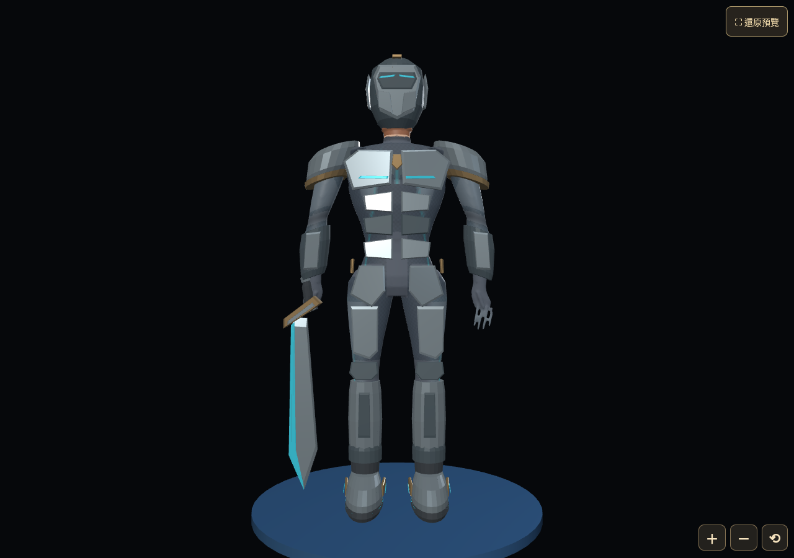

# 第28批剩餘整合施工與驗收｜2026-10-14

本輪合併施工，起點main `ff91116c655fbec22047d01e61e3554fa47451e9`。依[代理美術授權](BATCH28_DELEGATED_ART_REVIEW_AND_CONSOLIDATED_EXECUTION_2026-10-14.md)與[造型決策](BATCH28_G006_G007_G016_ART_DIRECTION_DECISION_2026-10-14.md)直接施工，沒有逐件等待批准。**使用者授權ChatGPT代理美術審查，非使用者親自逐張觀看。** 本機實測結果、CI與真機分層記錄；未解除正式B／FULL_3D_AVAILABLE發布限制。推送後exact-HEAD Actions必須另核對，不以本文預告全綠。

## 1. 實際完成內容

| 項目 | 成果／身份與版本 |
| --- | --- |
| G006正式拆件圖 | 實際重新目視候選完整頁／局部，柔性保溫内襯替代ARMOR四段完整硬脛殼，鞋欄長脛殼／冰爪不變；正式圖逐byte採候選v1，原圖存同套history/2026-10-14 |
| G007正式拆件圖 | 實際重新目視，ARMOR背面小圖變為空掛座／分節背甲，独立完整菱形鑰印与高脛靴保留；正式圖逐byte採候選v1，原圖留history |
| G007鞋槽 | 原source上增加完整高脛硬殼、前側機械凹面、踝／鞋底推進能源邊，雙腳同槽；shin／foot原骨映射，不含甲屬膝片 |
| G007甲槽 | 增加左右大腿／膝片、背部空機械座与脊柱層板；不含完整鑰印，原肩肘胸腰分件保留 |
| G007飾品槽 | 原粗平核心改為固定立體菱核、双深度金屬框與下柄；無自由漂浮片、無新增粒子／戰鬥／聲音時鐘 |
| G007盔／武器 | 原閉面上增加頰顎面片；原刀身增加刀背与護手層次，維持握柄／主長度、原不透明面与掛點 |
| 三LOD | 原五槽身份与路徑維持，15真GLB全部同步，原骨／bind／權重相容。小型鑰印100 triangles在三tier保留完整，避免低LOD抹掉核心與框；其他四槽依既有比例減面 |
| G016 | 長甲腿輪廓分件定案：大腿／膝归armor，硬脛殼／踝推進／双底归shoes，柔性内襯与膝下短翼不重複硬殼；原圖無須改，沒有建模型 |
| G001～G020收尾 | 正式100槽名、區域、sourceKey与每套人工規格核對保留；G006／G007代理概念批准2套，G007模型藝術版本綁定，另外18套仍原概念待審狀態，未冒稱它們有模型；210／1,050完整 |
| GM／B接線 | GM唯一開發預覽，原31案例／8分類、自由／只讀角色快照與B單方案保留；原Fixture／事件不重生，精修裝備走嚴格版本銜接，正式B仍受原發布限制 |

新模型是原技術框架的可用局部精修，不是全人物／全裝備重建；以共用PBR與必要輪廓控制手機下載，没有承諾將概念每條磨耗／微字均重建幾何。代理概念／模型藝術審查與工程通過／正式發布批准分開。

### 概念原／新SHA與追溯

G006原 `1d84fa4d7c284f4266eb6cff0dddbcdb9f6eb35aedf5322f1786859a751601ce` → 新 `7c7cf33eea9b08253f3645128de12b5ff1420bd14c94561617df8292d67579e8`。

G007原 `2959fd08a50d7968ec228a4c8115f65988d018a4c57d045d876eec5c107d0ac0` → 新 `ac1beed76e607a70e3d83b46deaf0bb9866e9d481ba77f3d2ff9b1ad34a7f38c`。

尺寸均1491×1055，新圖990,216／1,031,198 bytes；沿用局部候選的無損像素保留，沒有再次生成或壓縮整張。原另外38圖／兩套overview不變。每套art-review.json綁五名／sourceKey、两圖SHA、代理授權文件SHA及實際目視證據；工具新增代理方式驗證，不偽裝reviewer=user。G007原硬編碼保護SHA保持在archive驗證，新的權威圖SHA明确更新，毀損負例仍必須失敗。[局部原候選比較與像素證據](BATCH28_G006_G007_LOCAL_ART_CANDIDATES_2026-10-14.md)保留歷史，當時「未批准」由本輪綁定證據更新，不回寫歷史。

## 2. 真實模型／GM實圖

[high背面](evidence/batch28-consolidated/gm-poses/high-back.png) · [深蹲關節組合側面](evidence/batch28-consolidated/gm-poses/high-deepSquat-side.png) · [跨步側面](evidence/batch28-consolidated/gm-poses/high-stride-side.png)。助手實際看過原source Cycles正側背與這些GM實圖，確認長脛殼／獨立膝片、成對雙鞋、固定菱核与框、遮面和主要比例；採樣姿勢未辨出明顯分件穿透。深蹲測試保持root原位置，檢查的是膝髖／踝幾何組合，不偽稱完成新落地蹲下剪輯。

GM實圖為現有C-08自由fixture，catalog由原index只讀提供，隔離mock receiver；不是正式真帳號／雲端驗收。真正式B的資料路徑另以記憶體測試批准與原owner事件驗證，不解除真發布。原角色／背包／養成／地圖獨立預覽沒有復活。

## 3. 實際自我檢查與機器結果

| 命令／實測 | 結果／證據 |
| --- | --- |
| `blender -b --python-exit-code 1 --python .../refine_equipment.py`，其後`export_refined.py` | 原source局部精修／15GLB真匯出，原版留history封存；[初匯出](evidence/batch28-consolidated/blender-export.log)／[重匯出](evidence/batch28-consolidated/reexport.log) |
| `blender -b .../ancient-ruins.blend --python-exit-code 1 --python .../validate_source.py` | PASS：原53骨／9掛點矩陣、基底source SHA、正規權重、不透明材質与8骨姿勢有限值／剛性edge ratio；[log](evidence/batch28-consolidated/source-validation.log) |
| `blender -b .../ancient-ruins.blend --python-exit-code 1 --python .../render_review.py` | 真Cycles正側背／盔／關節圖完成；不是AI概念圖；[log](evidence/batch28-consolidated/render-review.log) |
| `node tests/runtime/3d-glb-validation.cjs` | 19登錄資產Khronos零error／warning，包含15精修裝備；[log](evidence/batch28-consolidated/glb-validation.log) |
| `node tests/runtime/3d-equipment-contract.cjs`／`3d-batch28-preflight.cjs`／`t3b-formal-assets.cjs` | PASS：身份／三LOD／53 joint-rest-bind、錯名／錯bind拒絕、空槽／缺材／stale取消／dispose及正式來源閘門；[裝備](evidence/batch28-consolidated/equipment-contract.log)／[preflight](evidence/batch28-consolidated/preflight.log)／[正式資產](evidence/batch28-consolidated/formal-assets.log) |
| `python3 scripts/equipment-concepts.py generate`／`validate` | 210／1,050、40图／20套、代理批准2套與G007模型藝術狀態相容；重跑零差異，標記外原人工內容不覆寫；[generate](evidence/batch28-consolidated/concept-generate.log)／[validate](evidence/batch28-consolidated/concept-validate.log) |
| `python3 -m unittest discover -s tests/equipment-concepts -v` | 29項PASS，保留原負例，新增代理授權SHA與原G007歷史圖毀損負例；[log](evidence/batch28-consolidated/concept-tests-final.log) |
| `node tests/runtime/3d-equipment-assets-browser.js` | PASS：真loader／GM、空槽／五單件／全裝／任意卸裝／双鞋、24遮面ray、30穿卸、mask精確恢復、三LOD、錯SHA／404、stale／關閉／熱重用；[log](evidence/batch28-consolidated/equipment-browser.log)／[JSON](evidence/batch28-consolidated/equipment-browser.json)。其中formal-preview部分是retired historical harness，不冒稱現行正式頁又有預覽 |
| `node tests/runtime/batch28-consolidated-browser.js` | PASS：**現行GM**低中高、各五單槽／空槽、mask恢复、頭轉俯仰／深蹲／跨步／膝踝實圖、退出engine=0；新增測試併入原Runtime workflow，没有獨立監控；[log](evidence/batch28-consolidated/gm-poses.log)／[JSON](evidence/batch28-consolidated/gm-poses/gm-pose-validation.json) |
| `node tests/runtime/t3b-formal-renderer-browser.js` | PASS：真正式Renderer／原人物GLB／相容剪輯、six clips 0／350／700ms、32可見子集合／100 engine切換釋放、三tier與視窗、context-loss／取消／owner clock；State／save／audio不變；[log](evidence/batch28-consolidated/formal-b-browser.log)／[JSON](evidence/batch28-consolidated/formal-b-browser.json) |
| `node tests/runtime/gm-battle-simulation-browser.js` | PASS：原始站台1280×800／390×844／844×390三尺寸與授權父頁檢查结果见[log](evidence/batch28-consolidated/gm-b-browser.log)／[JSON](evidence/batch28-consolidated/gm-b-browser.json)，未完成不得把某一尺寸PASS當全通過 |
| `node scripts/hybrid-comparison-fixtures.cjs --check`、playback／renderer／art contract | 原Fixture SHA `5a74c2ee...`完全可重現，原case／controls／事件未改；新資產視覺映射严格验证原註冊身份与17新SHA，來源原件／git baseline／archive／新版本全鏈核驗；[fixture](evidence/batch28-consolidated/fixture-check.log)／[playback](evidence/batch28-consolidated/playback-contract.log)／[12 renderer contracts](evidence/batch28-consolidated/source-and-contract.log)／[art contract](evidence/batch28-consolidated/art-contract.log) |
| 發布audit／dry-run／manifest／docs／exact-HEAD CI | 推送前實際執行，log保留本證據目錄；CI未完成不稱全綠，最終交付報告提供結果 |

B的反擊依**真正傷害事件**使用既有attack／return表現，counter標記本身不虛構打擊；受擊／閃避／敗北用原hit／dodge／defeat；勝利沿原outcome／return，不宣稱本輪另外製作一套勝利剪輯。所有驗收使用原合法事件、既有presentation owner，不改傷害／RNG／結算。

實際發布包亦用390×844手機尺寸執行同一完整GM測試與授權父頁，已PASS；[發布包log](evidence/batch28-consolidated/published-gm-browser.log)／[JSON](evidence/batch28-consolidated/published-gm-browser.json)，不是只測source頁。

### 發現與修正，不放寬舊有效測試

低LOD鑰印初匯出被原100 triangles下限攔下：保留小型固定核心／框100 triangles於三tier，其他槽仍三LOD，不降低測試門檻。概念批准由2套代理狀態取代原0套，測試改核對具體身份與授權，並新增篡改負例，沒有把批准結構測試移除。

GM初次失敗是舊Fixture鎖原registry／裝備SHA，与精修資產不一致；保留原registry文字／15GLB／原adapter與producer的inert source.txt，Fixture仍讀原資料可逐byte重現。新增嚴格版本證據把已驗證input的裝備視覺身份接到当前登錄SHA，不動原數值／事件。另統一fixture adapter／Playback／Renderer模块query，修正WeakSet因不同版本實例導致的Invalid offline input；GM／開發比較入口cache-bust与manifest一起更新。A／C圖集歷史沒有重烘焙，不把這輪當新A/B/C美術優劣比較。

自動審核曾拒絕改寫T4來源歷史鎖，已保持舊lock完全不變；只允許從ff91116c精確原GM source做一次已授權import query替換，其他字元必須一致。其餘新增source evolution是獨立授權版本链，舊源SHA／git history／archived bytes均驗證，禁止任意路径或错名代換。没有透過降低source檢查製造綠燈。

新增GM截圖初遇定位器等待畫布穩定逾時；改讀實際畫布bounding box後截圖，資料／骨／穿卸與释放断言保留；世界轴与骨local轴的姿勢施加亦校正，側視確認實際膝彎曲。環境重啟使一輪GM執行session丟失，檔案仍在；恢復後重跑，未將部分log冒稱完成。工具依賴沿已裝NODE_PATH與system Chromium使用，真手機GPU未驗。

## 4. 容量、保護資產與回退

精修low五件315,652 bytes、medium395,168、high447,512；15GLB合計1,158,332，比原1,028,860增加129,472 bytes。原每tier小於450,000 bytes門檻保留，無新裝備圖集／重複人物動畫／模型貼圖母檔發布。100-triangle小型鑰印保持三tier同主輪廓是取捨，不偽造不存在LOD。

原source與15GLB／registry／review封存於`development/3d-source/equipment/ancient-ruins-v1/history/before-refinement-2026-10-14.tar.gz`（10,392,405 bytes）；另存原15GLB与registry／adapter／producer source.txt供Fixture精確重現，全部不屬玩家正式預載。原38圖、人物GLB／blend／骨架／掛點、正式根目錄JS／CSS／HTML与所有戰鬥／存檔／雲端／音訊／背景／極簡owner不變，见[保護範圍證據](evidence/batch28-consolidated/protected-assets.json)。本輪只增裝備及必要GM／開發版本接線，没有新正式裝飾預覽或其他套冒名。

回退整組本輪提交即可；必要時在隔離副本解封原G007source／15GLB及兩圖history，核對原SHA後再恢复，勿直接覆寫人物基底／玩家資料。重匯出用export_refined.py，refine_equipment.py只對原版执行一次、有重跑guard，不以旧build工具重建本次人物。

## 5. 本批结案界線與真正待驗

本輪目標是G006/G007正式局部圖、G007可用精修五槽／三LOD、G016最終規格、前20套名稱／notes／状态收尾与工程验收，不擴大到190套量產。前18套圖與未造模型狀態如實保留，不假定概念批准等於技術或發布通過。

- 真iPhone／Safari直横、30分鐘GPU／熱／弱網與原GM返回操作待實機；桌機Chromium手機viewport不是實機。
- 第二套真模型完成前的跨兩套／跨接口族真实混穿待驗；目前32種G007子集合与G006缺材拒絕不能代替。

以上兩項依使用者規則不阻工程結案。本機完整驗收已通過，本輪工程成果已完成。exact-HEAD Actions未完成或失败仍要继续核對／修正，不能只凭本機宣稱發布驗收全綠。G007 Blender精修已在本輪实际做完，不再留为下一個小批；G016完整模型與G021／宇宙／高維素材仍不施工。
