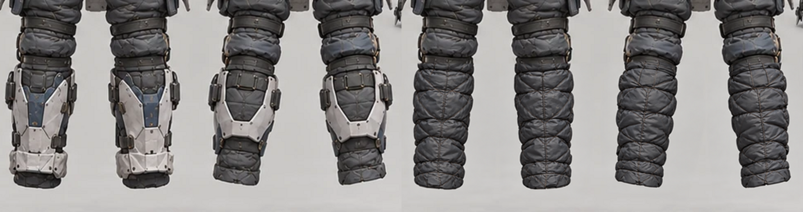
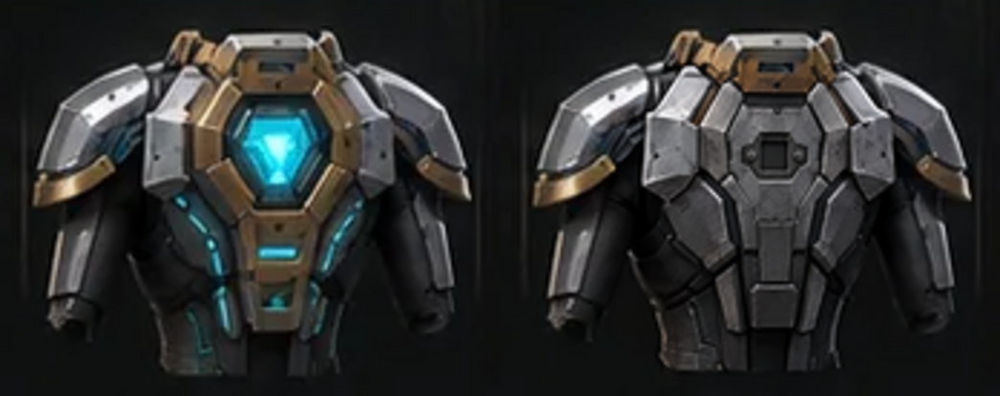

# 第28批 G006／G007 局部修圖候選與驗證｜2026-10-14

**兩張候選v1已實際完成，可供使用者逐圖美術審核；未批准、未替換原圖。** 最新main起點`8ac052828e34a56c2f4655db68172cf07349421a`，承接[使用者造型決策](BATCH28_G006_G007_G016_ART_DIRECTION_DECISION_2026-10-14.md)、共用五槽契約／前次重整／G007精修規格與原概念SOP。只製作兩張拆解圖局部候選，G016、G007模型與其餘素材不施工；正式程式、裝備名、索引、批准與發布開關不動。

## 1. 原圖與候選位置／指紋

| 項目 | 原圖 | 獨立候選 |
| --- | --- | --- |
| G006 | [equipment-five-slots.webp](../development/3d-source/equipment/concepts/galaxy/g006-polar-front/equipment-five-slots.webp) | [候選v1](../development/art-candidates/batch28-g006-g007-2026-10-14/g006/equipment-five-slots.candidate-v1.webp) |
| G006尺寸／bytes | 1491×1055／277,736 | 1491×1055／990,216 |
| G006 SHA-256 | `1d84fa4d7c284f4266eb6cff0dddbcdb9f6eb35aedf5322f1786859a751601ce` | `7c7cf33eea9b08253f3645128de12b5ff1420bd14c94561617df8292d67579e8` |
| G007 | [equipment-five-slots.webp](../development/3d-source/equipment/concepts/galaxy/g007-ancient-tech-ruins/equipment-five-slots.webp) | [候選v1](../development/art-candidates/batch28-g006-g007-2026-10-14/g007/equipment-five-slots.candidate-v1.webp) |
| G007尺寸／bytes | 1491×1055／201,726 | 1491×1055／1,031,198 |
| G007 SHA-256 | `2959fd08a50d7968ec228a4c8115f65988d018a4c57d045d876eec5c107d0ac0` | `ac1beed76e607a70e3d83b46deaf0bb9866e9d481ba77f3d2ff9b1ad34a7f38c` |

候選完整圖採無損WebP，是為了保留非目標區域**原解碼像素**；不是重新生成全頁。每張高於SOP建議800KB，已明列原因且未發布，約2.02MB候選合計留development，沒有擅自壓原圖或新增預載。既有40原圖容量與SHA完全不變。

## 2. 實際局部影像編修與目視結論

先用ImageMagick只讀解碼／裁切原圖：G006 `(x=485,y=650,w=490,h=260)`，G007 `(748,662,174,138)`；助手已看原完整頁與局部。使用影像編修工具 `image_gen` 分別編修**兩個原裁切**，要求原比例／材質／視角／構圖及指定內容，沒有重生整張。輸出按原裁切尺寸適配，再以局部灰階選區合成；选區邊緣有限羽化，保存實際使用的patch与mask可追溯。Python僅用於解碼、數值比對及來源驗證，未用來畫圖或代替影像編修。

初次三輸入合成未正確套用選區，像素檢查攔下裁切內非目標變化；已改為明確`CopyOpacity`後`Over`合成。局部放大目視又發現少量邊緣硬件殘留，調整選區移除後重新合成、重新驗證。舊草稿未冒充完成品或提交為候選。

### G006｜移除鎧甲欄硬脛殼

助手實際檢視候選完整頁與放大局部：ARMOR正／背四段小腿不再帶銀白／藍色完整硬殼及硬踝套，而是深灰柔性保溫內襯，可見縫線、皺褶與填充體積，非平塗色塊；與上方既有布料連接。膝以上甲、頸口、武器／頭盔／鞋／飾品及文字保留；鞋欄完整長脛殼、成對冰爪鞋底仍在。低像素概念頁上的接口表達可供審核，並不等於Blender縫合或動作穿模驗收。

### G007｜背甲移除重複鑰印

助手實際檢視候選完整頁與放大局部：僅ARMOR背面小圖的亮青鑰印核心、完整金屬框／下柄被移除；原位置呈現分節灰金屬背甲与中央小型、無光、凹入的空機械掛座及固定點。原肩甲／側臂外輪廓與五欄版面保留；獨立ACCESSORY欄的菱形核心、框架與原展示分件完全不改，高脛靴全欄保留。其餘中文名稱／說明與主胸甲沒變；沒有順便把右欄原展示改為新的固定／漂浮圖版。固定立體鑰印的後續Blender實作仍留下一階段。

以上是助手的候選目視檢查，不是使用者美術批准。可審核材質與分件清晰度，不能宣稱正式模型或動態穿卸已通過。

## 3. 像素範圍、正式名稱與來源保留

| 檢查 | G006 | G007 |
| --- | --- | --- |
| 完整解碼／尺寸 | PASS，1491×1055 | PASS，1491×1055 |
| 變動像素 | 75,216 | 11,200 |
| 變動bounding box，左上含／右下不含 | `(485,724)～(975,897)` | `(781,681)～(891,799)` |
| 指定局部mask外變動像素 | **0** | **0** |
| 原始目標WebP SHA | 未變 | 未變 |
| 其餘槽、標題／名稱／順序 | 原像素保留 | 原像素保留 |

[差異圖G006](../development/art-candidates/batch28-g006-g007-2026-10-14/g006/difference-map.png)／[G007](../development/art-candidates/batch28-g006-g007-2026-10-14/g007/difference-map.png)：暗區為未變、亮色為變動。mask外逐RGB像素相同，這是區域保留證據；美術判斷另依上節實際目視，沒有只看SHA宣布合格。

正式五名依原index，排列仍weapon／helmet／armor／shoes／accessory：

- G006：霜鋼長刃／極寒封閉盔／冰原保溫甲／雪地抓地靴／熱源定位器。原圖欄名使用英文，未擅自添加／重寫中文文字；正式中文名仍在原notes／index，本報告列出對應。
- G007：古代光刃／遺物守衛盔／自律護衛甲／遺跡浮行靴／古文明鑰印。原中文標題及五槽名稱像素不變。

143個保護檔案逐SHA通過：40原概念圖（含另外38張、兩套原三視圖）、G007十五GLB、blend／rig-contract／source-validation／工具／掛點／來源、人物資產與來源、asset registry、concept index／identities與manifest。210套／1,050位置保留，所有conceptApproved=false、approvalEvidence=null。基準git diff僅新增候選／報告／證據，無正式或既有檔修改。

## 4. 實際測試、提交與承接

- `python3 /tmp/check-local-art.py`：PASS，143保護檔SHA、40原圖、兩候選完整解碼、同尺寸、mask外0像素變化；[log](evidence/batch28-local-art/pixel-and-preservation.log)／[詳細JSON](../development/art-candidates/batch28-g006-g007-2026-10-14/review-evidence.json)。沒有執行會写回原圖的generate。
- `python3 scripts/equipment-concepts.py validate`：PASS；210套／1,050、40原圖／20套、0批准与19套未建模狀態保留；[log](evidence/batch28-local-art/concept-validate.log)。
- `node tests/runtime/3d-equipment-contract.cjs`：PASS；原15GLB／53骨／bind／weights／來源與原基底未變；[log](evidence/batch28-local-art/equipment-contract.log)。
- `node scripts/publish-asset-audit.cjs`與發布選擇清單：結果見[發布審計log](evidence/batch28-local-art/publish-audit.log)；候選整目錄必須excluded，絕不進正式publish／SW預載。
- `node tests/runtime/docs-integrity.js`及`git diff --check`：結果見[文件log](evidence/batch28-local-art/docs-integrity.log)及最終回報。

提交SHA與exact-HEAD Actions推送後核對，未完成不得套用前SHA綠燈；本報告不預告全綠、不新增監控。候選具備逐圖美術驗收條件；使用者可查看完整頁与局部左原／右候選，確認內襯質感／空掛座和其餘欄位。批准或取代正式圖仍需明確版本指示，這次沒有批准／取代。G007 Blender精修、G016建模、G021後素材全部未動；回退只需revert本次新增候選／報告提交，原來源不受影響。
