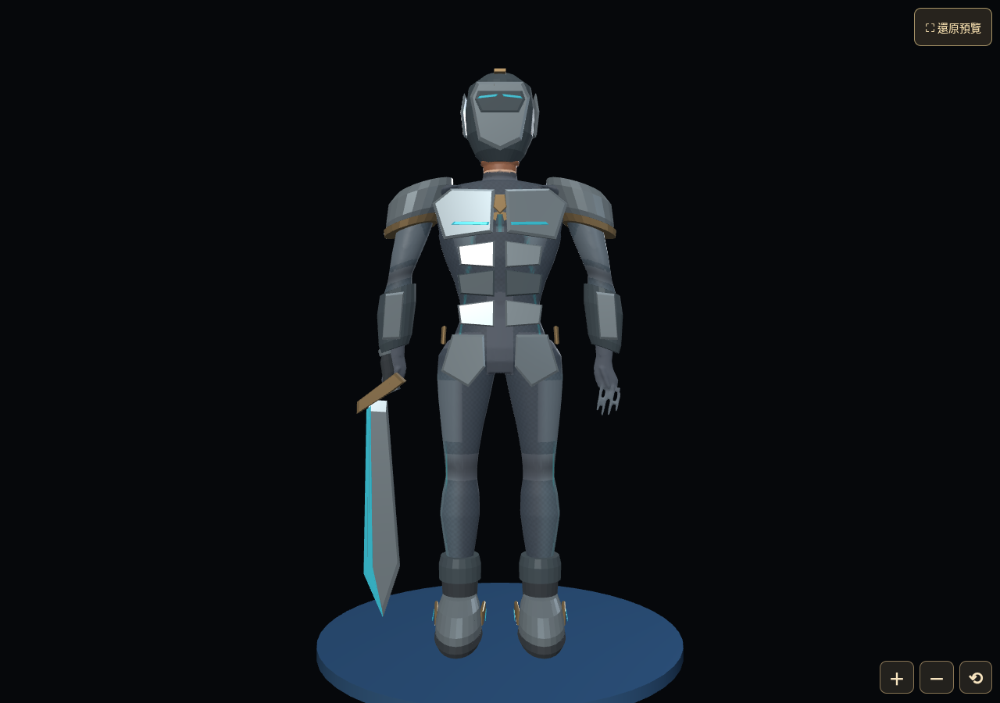

# G007 概念與既有五槽模型差異｜2026-10-13

> **建議與待使用者審核**。基準 `f8d707694835a9bfce555a7eb1a754ded3a174ff`。本次沒有重建／修改G007、玩家基座、GLB、blend、索引、正式程式或批准狀態。建議補修不代表取得施工授權。

## 一、實際比較的來源

- [概念三視圖](../development/3d-source/equipment/concepts/galaxy/g007-ancient-tech-ruins/overview-front-side-back.webp)，SHA `0f9ad6179ac17fbd94f46897c433ce9003f19cb4290bc46c49ddbfd21ff67645`。
- [概念五槽](../development/3d-source/equipment/concepts/galaxy/g007-ancient-tech-ruins/equipment-five-slots.webp)，SHA `2959fd08a50d7968ec228a4c8115f65988d018a4c57d045d876eec5c107d0ac0`。
- 原 `ancient-ruins.blend`、rig-contract／source-validation、原15 GLB、registry來源與授權SHA均保留；逐件bytes／SHA見[只讀快照](evidence/batch28-review/G001_G020_REVIEW_SNAPSHOT_2026-10-13.json)。不得從slug推正式名稱。
- 已目視歷史Cycles front／side／back／helmet與GM front／back。另在**最新GM C-08角色全身展示**載入原high五件，free fixture、強化0、同一觀察攝影機取正側背。來源目錄由核對後的原索引派生，經隔離mock receiver提供；不是正式帳號或權限／雲端驗收。metadata確認assetId全部为原G007 high、appearanceSource=fixture、readOnly=true；pagehide後engine=0、pageerror空。

[本次側面](evidence/batch28-review/g007-current-side.png) · [本次背面](evidence/batch28-review/g007-current-back.png) · [實際GM metadata](evidence/batch28-review/current-gm.json)。這些是新審查截圖，不是新概念圖、材質修圖或模型改版。

## 二、五槽差異與建議

| 正式槽／名称 | 概念看見的形體 | 現有實際模型 | 建議與優先度 |
|---|---|---|---|
| weapon／古代光刃 | 有分層刀背、護手／握柄、沿刃能源槽、作用端转折和細節厚度 | 獨立socket-local厚刃、簡單斜金護手、青邊存在；刀身以宽平面构成、能源槽與握柄層次明顯簡化，觀感不能因high LOD就等同概念 | P1：保留掛載與可逆右指握持；選定長寬／重心后补刃截面与护手轮廓、必要normal细节，不重复动画 |
| helmet／遺物守衛盔 | 锐面冠頂、額／頰／下顎分區、侧耳环、窄青感測面 | 封闭实体、青感測片及侧片成立，但球冠多边外壳与面甲层次比较粗、耳部与接缝简单 | P1：保留封閉面与53joint weights；補面片／側機構輪廓与表面材质；不要用透明面窗或删整头降低难度 |
| armor／自律護衛甲 | 肩／胸／腹／前臂／腰胯细密斜甲；三视图另有大腿、膝脛甲 | 肩弧片＋多块平胸腹板＋前臂／腰片，可独立穿卸，但大腿／膝／脛多为基底服；缺概念精密层次，背板仍是简单分件 | P0先选定下腿属于哪槽；P1后局部补造型与材质，不把不明确腿甲直接全部焊进armor；不能重做玩家rig |
| shoes／遺跡浮行靴 | 长脛壳、踝侧推进器、成對鞋底能源圈／分层 | 一槽两脚成立、踝跟随正确；现有短靴／粗踝圈、简单鞋头与侧金条，缺高脛主体与完整推进层次 | P1：根据下腿所有权補高／低靴版本及推进器主轮廓，保留双foot绑定与可逆feet区域；膝踝活动另测 |
| accessory／古文明鑰印 | 青菱形立体核、分层铜框与分解悬浮小片；侧视有厚度 | 真背socket独立钥体，八角框＋平青核＋下柄，与背板分别加载；没有完整菱形能源核／多层片，艺术轮廓被简化 | P0先定概念拆件背板的重复核心；P1保留独立key资产，補核与必要框层；漂浮片可烘焙／简单材质，不强制新增骨架或持续粒子 |

图中银灰／深铁灰、少量青铜、青能源的意图與舊模型总体一致；但旧模型本身以少量PBR材质／颜色及几何为主，装备GLB未含图片贴图。整体外观不具概念中的磨耗、细小符号、材质微细对比。**多边形数量不是单独的美术评分**；结论依据实际high画面中缺失的轮廓层次。新材质与法线是否必要，须在固定3/4及手机投影大小下量测后决定，不能为每颗螺丝加几何。

## 三、穿模／遮蔽判定边界

本次静态正侧背没有辨出裸露五官、重复第二双鞋或明显穿透身体的背饰；颈部可见皮肤不等于露出脸，穿着头盔不能直接判违反遮脸规则。侧面刀身与腿／鞋投影很近，不能只凭2D重叠确认三角相交。胸板局部白色高光也不是已确认穿模。

尚待：头转／上下视极限、肩肘交叉、弯腰深蹲、长刃挥击与反击、左右腿跨步、背饰厚度与甲板的实际距离，以及低中高LOD切换后覆盖是否一致。这些应由Blender和真正Runtime几何／屏幕证据验证，不用伤害公式修掩外观。19套未建模型，本次不能声称已验证它们与G007混穿碰撞。

概念拆件ARMOR背面小图仍有鑰印，和独立accessory栏重复；这是**概念分件输入歧义**。现有GLB／Runtime使用独立key，原卸装测试能恢复背部index，不能因图面重复倒推Runtime必然重复挂饰。

## 四、已有技术／历史覆盖／本次复验／艺术待审

| 项目 | 已有覆盖 | 本次结论／限制 |
|---|---|---|
| 53骨／9挂点／三LOD | 原joint顺序／parent／rest／inverse bind、权重归一与毁损负例；rig v1 | 本次contract通過；Blender只读实际53／9、18人物装备GLB及source SHA通過。无需重做人物 |
| 独立五槽 | 原空装、五单件、全穿、卸任意槽、双鞋、index恢复、30次穿卸、stale取消 | 本次preflight通過，最新GMhigh五件实载与退出engine=0；没有重跑全部历史browser或宣称完整热切 |
| 混穿 | 原32可见G007子集合、B Renderer多tier、缺件G006／混搭fixture | 已证实的是同套子集合与未知名拒绝；不等于两套已完成模型之间全部混穿 |
| 动作与遮面 | 原8个骨姿势、刚性甲片edge ratio .99～1.01、24条面罩ray、头／肩／肘／髋／膝／踝／握持；T3-B已有相容动作／释放记录 | 不等于完整攻击碰撞；本次没有伪造新8姿势／24ray数据 |
| 故障与释放 | 原helmet404／错误SHA、其他四件存活／脸区恢复、同LOD热开0新增GLB请求、30循环、context loss；B100次engine释放 | 原证据保留，本次契约／preflight＋最新GM单次释放复核；iPhone长测未验 |
| 來源與容量 | 原CC0工具／blend、preload=false、按需三LOD，不重复装备动画／图集 | 原15资产及源指紋一致，G007不被代换其他套名；不改發布清單 |
| 美术与批准 | 索引existing-model-concept-alignment-unverified、conceptApproved=false | 模型技术通過，不等于概念对齐或艺术封版；本次0批准 |

歷史證據：`docs/3D_BATCH28C_BROWSER_MEASUREMENTS_2026-10-11.json`、`docs/3D_BATCH28C_CAPACITY_2026-10-11.json`、`development/3d-source/equipment/ancient-ruins-v1/source-validation.json`，以及上次`docs/evidence/gm-background-compatibility/equipment-assets-current.json`／`formal-b-renderer-current.json`。后两份有实测证据，但retired-preview-harness不能冒称目前正式页面重新有预览；如今唯一开发入口仍是GM。

## 五、建议最少重工路径

1. 使用者先明确概念版本、饰品唯一所属、下腿／鞋界与浮行机构；本次仅提出意见，不批准。
2. 保留原blend／15GLB与身份／骨架／三LOD／挂点／回退路径，不直接重建G007；只对选定轮廓、独立部件与材料补艺术层。
3. Codex在原source中补改、检查rig/bind不漂移，重新导出相同五槽／三tier与SHA后才走正常登记与验收。未授权前不执行此步。
4. 只用GM原角色／装备／B战斗入口交叉看动作、空槽、卸装／混穿／手机，补几何碰撞与真机证据；不恢复正式角色／背包／地图独立3D。
5. 验证后由使用者决定是否批准模型与后续建模；不得用CI把conceptApproved改为true或解除正式B发布开关。

原15装备容量不变：low五件283,084 bytes、medium五件351,184 bytes、high五件394,592 bytes，三tier总计1,028,860 bytes。它们是当前工程基线，不是未来所有套装容量上限。
